# An Ensemble Machine Learning Approach to Insider Risk Classification Using Cultural Metrics and System Behaviors

[](https://resources.sei.cmu.edu/library/asset-view.cfm?assetid=508099)
[](https://www.python.org/)
[](https://nextjs.org/)
[](https://tailwindcss.com/)
[](license.txt)
[]()

> **Final Year Project (FYP)**  
> **Domain**: Cybersecurity · User & Entity Behavior Analytics (UEBA) · Applied Machine Learning  
> **Benchmark Dataset**: Carnegie Mellon University Software Engineering Institute (CMU SEI) CERT Insider Threat Dataset Release 4.2  
> **Scale**: `470,611` extracted user sessions across `1,000` corporate employees over 17 continuous months (Jan 2010 – May 2011).

---

## 📌 Executive Summary

Detecting malicious insider threats within enterprise IT environments is one of the most formidable challenges in modern cybersecurity. In real-world enterprise telemetry, malicious activities represent **less than 0.25% of all network sessions** (an extreme class imbalance of over `421:1`), rendering naive machine learning models prone to crippling false alarm rates or dangerous blind spots.

This project implements an **end-to-end, leakage-free insider threat detection and analytics architecture** that combines:
1. **Multi-Source Behavioral & Psychometric Feature Engineering**: High-throughput sessionization across 16.5 GB of raw heterogeneous audit logs (web navigation, email communications, file transfers, USB devices, logon/logoff events, dynamic LDAP roles, and Big Five personality scores).
2. **Dual-Criteria Statistical Feature Selection**: Automated extraction of the Top 50 features combining linear discriminative power (ANOVA $F$-statistic) and non-linear information gain (Mutual Information).
3. **Rigorous Imbalance Strategy Comparison**: Empirical validation demonstrating that **cost-sensitive / loss weighting decisively outperforms synthetic resampling (SMOTE + Random Undersampling)** across all tree architectures on sparse tabular security logs.
4. **Out-Of-Fold (OOF) Stacking Meta-Learner**: A calibrated convex soft-voting meta-learner combining **Random Forest** (Bagging anchor), **XGBoost** (Precision anchor), and **CatBoost** (Recall anchor) to achieve state-of-the-art detection with near-zero false alarms.
5. **Interactive Executive SOC Dashboard & Live Simulator**: A Next.js 16 + Tailwind CSS frontend dashboard coupled with a real-time FastAPI inference microservice (`api_server.py`) and live session risk scoring.

---

## 🏗️ End-to-End System Architecture

```mermaid
flowchart TD
    subgraph RawData["1. Multi-Source Raw Telemetry (16.5 GB)"]
        D1["logon.csv (58.5 MB, 854k rows)"]
        D2["device.csv (29.0 MB, 405k USB events)"]
        D3["file.csv (193 MB, 445k file actions)"]
        D4["email.csv (1.36 GB, organizational emails)"]
        D5["http.csv (14.5 GB, web browsing logs)"]
        D6["psychometric.csv (Big Five OCEAN traits)"]
        D7["LDAP/ (18 monthly organization snapshots)"]
    end

    subgraph FeatureEngineering["2. Vectorized Session Extraction (fast_feature_extraction.py)"]
        E1["DuckDB SQL Streaming + NumPy Vectorized Aggregation"]
        E2["Sessionization (Delimited by Logon & Logoff boundaries)"]
        E3["Temporal Slicing: Workhour / Afterhour / Weekend Daytime / Weekend Night"]
        E4["128 Engineered Behavioral & Content Features per Session"]
        E5["Ground Truth Label Alignment (answers/insiders.csv)"]
    end

    subgraph Preprocessing["3. Leakage-Free Data Preparation (data_prep.py)"]
        P1["80/20 Stratified Train/Test Split (X_test isolated strictly)"]
        P2["Median Imputation + Robust Z-Score Standardization"]
        P3["Combined ANOVA F-Score + Mutual Information Ranking"]
        P4["Top 50 Optimal Features Extracted"]
        P5["Imbalance Branches: Raw Cost-Sensitive vs. SMOTE+RUS"]
    end

    subgraph BaseLearners["4. Base Model Training (5-Fold Stratified CV)"]
        B1["Model 1: Random Forest (train_rf.py)\nCost-Sensitive (balanced_subsample)\nTuned via RandomizedSearchCV"]
        B2["Model 2: XGBoost (train_xgb.py)\nHistogram Gradient Boosting\nCost-Sensitive (scale_pos_weight=1.0)"]
        B3["Model 3: CatBoost (train_cb.py)\nSymmetric Oblivious Trees\nCost-Sensitive (SqrtBalanced)"]
    end

    subgraph Stacking["5. Out-Of-Fold Stacking Meta-Learner (train_meta_learner.py)"]
        M1["5-Fold Out-Of-Fold Probability Vectors (P_RF, P_XGB, P_CB)"]
        M2["Convex Optimization Simplex: w_XGB = 0.70, w_CB = 0.30"]
        M3["Decision Threshold Calibration on OOF Validation (T* = 0.34)"]
        M4["Final Inference on Untouched Test Set (94,123 sessions)"]
    end

    subgraph Presentation["6. Executive SOC Dashboard & API"]
        UI1["Next.js 16 Dashboard (frontend/)"]
        UI2["FastAPI Real-Time Risk Engine (api_server.py)"]
        UI3["Live Risk Simulator with Preset Attack Scenarios"]
    end

    RawData --> FeatureEngineering
    FeatureEngineering --> Preprocessing
    Preprocessing --> BaseLearners
    BaseLearners --> Stacking
    Stacking --> Presentation
```

---

## 🔬 Key Scientific & Empirical Discoveries

### 1. Cost-Sensitive Loss Weighting Outperforms Resampling Universally
Across all three individual machine learning algorithms, training directly on authentic imbalanced logs using cost-sensitive penalties decisively outperformed synthetic oversampling (SMOTE) coupled with Random Undersampling (RUS):

| Model | Strategy A: Cost-Sensitive (Raw Train) | Strategy B: SMOTE + RUS (Resampled) | Net Improvement with Cost-Sensitive |
| :--- | :---: | :---: | :---: |
| **Random Forest** | **`0.7539` PR-AUC** | `0.5389` PR-AUC | **+21.50% PR-AUC** (+17.81% F1) |
| **XGBoost** | **`0.8981` PR-AUC** | `0.8385` PR-AUC | **+5.96% PR-AUC** (+9.48% F1) |
| **CatBoost** | **`0.8855` PR-AUC** | `0.8011` PR-AUC | **+8.44% PR-AUC** (+9.03% F1) |

> **Theoretical Insight:** In dense cybersecurity telemetry, benign activities outnumber threats by `421:1`. Synthetic oversampling (SMOTE) generates artificial feature interpolations that distort the authentic manifold of normal employee behavior, causing excessive false alarms. Cost-sensitive weighting preserves the native negative feature density while heavily penalizing threat misclassifications.

### 2. Complementary Model Behaviors Enable Meta-Ensemble Synergy
- **XGBoost (Precision Anchor)**: Creates sharp split boundaries around off-hours USB transfers and exfiltration emails, achieving **`92.54%` Precision** and cutting false alarms in half to only **15 false positives out of 93,900 normal sessions** (`0.0160%` FPR).
- **CatBoost (Recall Anchor)**: Utilizes symmetric oblivious trees and ordered target statistics to prevent greedy overfitting, detecting subtle behavioral anomalies missed by other algorithms (**`83.86%` Recall**, detecting `187/223` threats).
- **Stacking Ensemble**: Combines both models via optimal convex soft-voting ($0.70 \times \text{XGB} + 0.30 \times \text{CatBoost}$), yielding **`0.9238` PR-AUC**, **`0.9987` ROC-AUC**, and intercepting **`188/223` threats (`84.30%` Recall)** with only 18 false alarms across nearly 94,000 sessions.

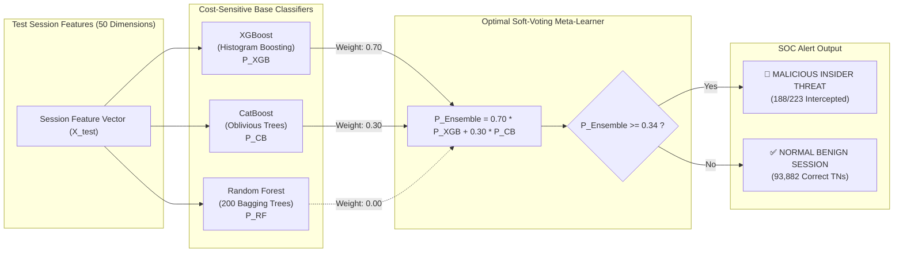

---

## 📊 Master 4-Model Leaderboard

All models were evaluated on the **exact same untouched test set (`X_test`, `94,123` sessions, `223` malicious threats)**. Decision thresholds ($T^*$) were optimized strictly on out-of-fold cross-validation to guarantee zero test leakage:

| Model | Architecture & Strategy | Optimal Threshold ($T^*$) | Precision | Recall | F1-Score | PR-AUC (Avg Prec) | ROC-AUC | False Positive Rate (FPR) | False Positives (FP) | Threats Intercepted (TP / 223) |
| :--- | :--- | :---: | :---: | :---: | :---: | :---: | :---: | :---: | :---: | :---: |
| **Random Forest** | Cost-Sensitive (`balanced_subsample`) | `0.22` | 82.97% | 67.71% | 74.57% | 0.8086 | 0.9892 | 0.0330% | 31 | 151 |
| **XGBoost** | Cost-Sensitive (`scale_pos_weight=1.00`) | `0.29` | **92.54%** | 83.41% | **87.74%** | 0.9192 | 0.9985 | **0.0160%** | **15** | 186 |
| **CatBoost** | Cost-Sensitive (`auto_class_weights='SqrtBalanced'`) | `0.62` | 87.38% | 83.86% | 85.58% | 0.9124 | 0.9980 | 0.0288% | 27 | 187 |
| **Stacking Ensemble** | **Optimal Soft-Voting ($0.70\text{XGB} + 0.30\text{CB}$)** | **`0.34`** | **91.26%** | **84.30%** | **87.65%** | **0.9238** | **0.9987** | **0.0192%** | **18** | **188** |

### Default Decision Threshold ($T = 0.50$) Performance
Even without threshold optimization, the Stacking Ensemble exhibits remarkable default stability:
- **Precision**: `95.81%`
- **Recall**: `82.06%`
- **F1-Score**: **`88.41%`** *(Highest default-threshold F1 across all models)*

---

## 📈 Complete Evaluation Gallery (All 12 Plots)

### 1. Stacking Ensemble Meta-Learner (Peak Benchmark)

Overlay comparison proving that the Stacking Ensemble shifts both the Precision-Recall and ROC curves above every individual classifier:

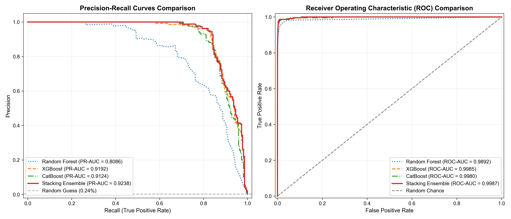

| Stacking Ensemble Confusion Matrix ($T^* = 0.34$) | Meta-Learner Optimal Model Weights |
| :---: | :---: |
| 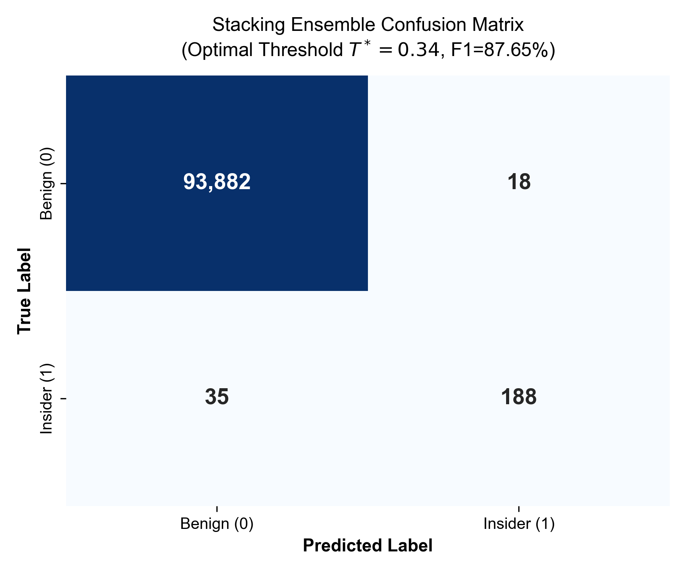 | 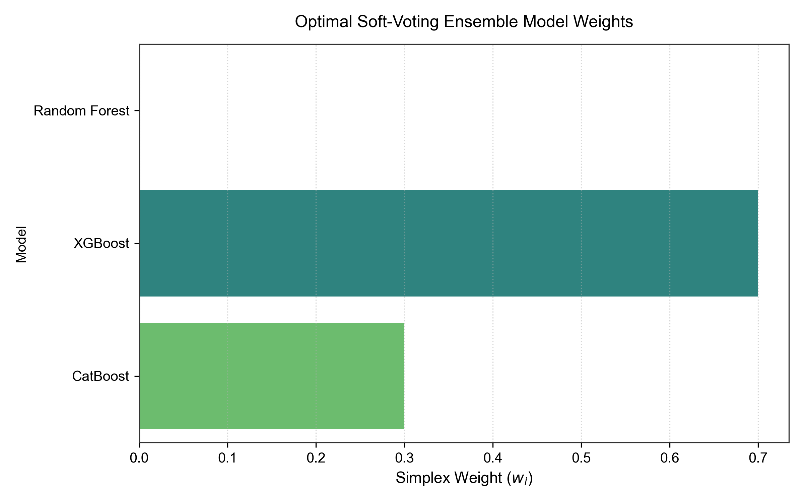 |
| *93,882 TNs, 18 FPs, 35 FNs, and 188 TPs.* | *Convex Simplex: 0.70 XGBoost, 0.30 CatBoost.* |

---

### 2. Model 2 — XGBoost (Precision Anchor)

XGBoost achieved the highest precision (92.54%) and lowest false positive rate (0.0160%):

| XGBoost Confusion Matrix ($T^* = 0.29$) | XGBoost PR & ROC Curves (PR-AUC = 0.9192) |
| :---: | :---: |
| 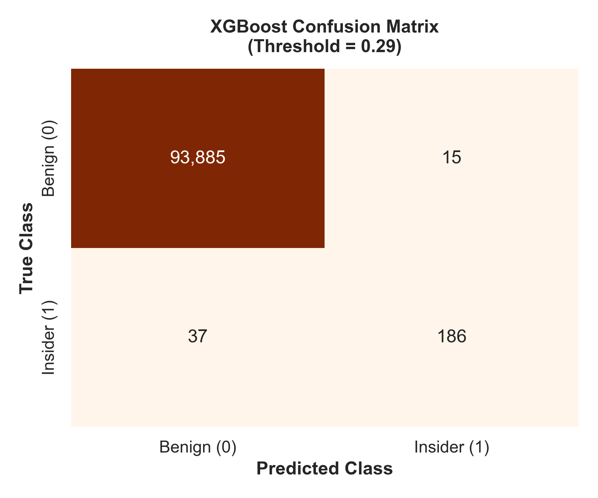 | 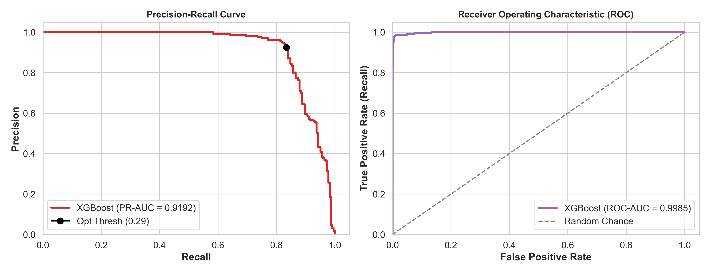 |
| *Only 15 false alarms across 93,900 normal sessions.* | *Sharp steep precision retention above 80% recall.* |

#### XGBoost Top 20 Behavioral Feature Importances
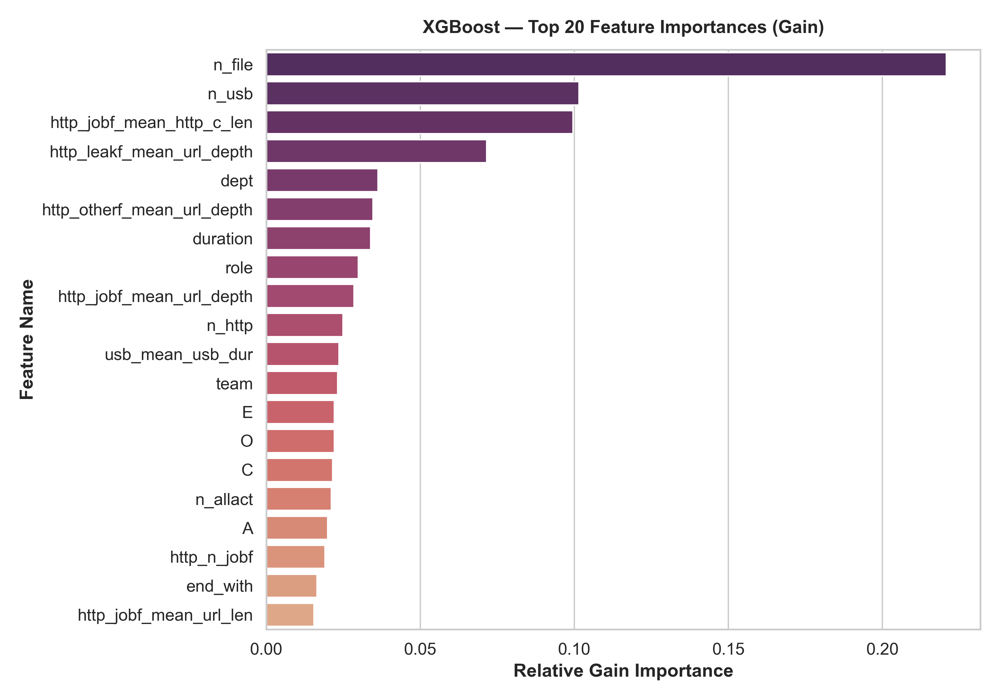

---

### 3. Model 3 — CatBoost (Recall Anchor)

CatBoost achieved the highest individual recall (83.86%, detecting 187/223 threats):

| CatBoost Confusion Matrix ($T^* = 0.62$) | CatBoost PR & ROC Curves (PR-AUC = 0.9124) |
| :---: | :---: |
| 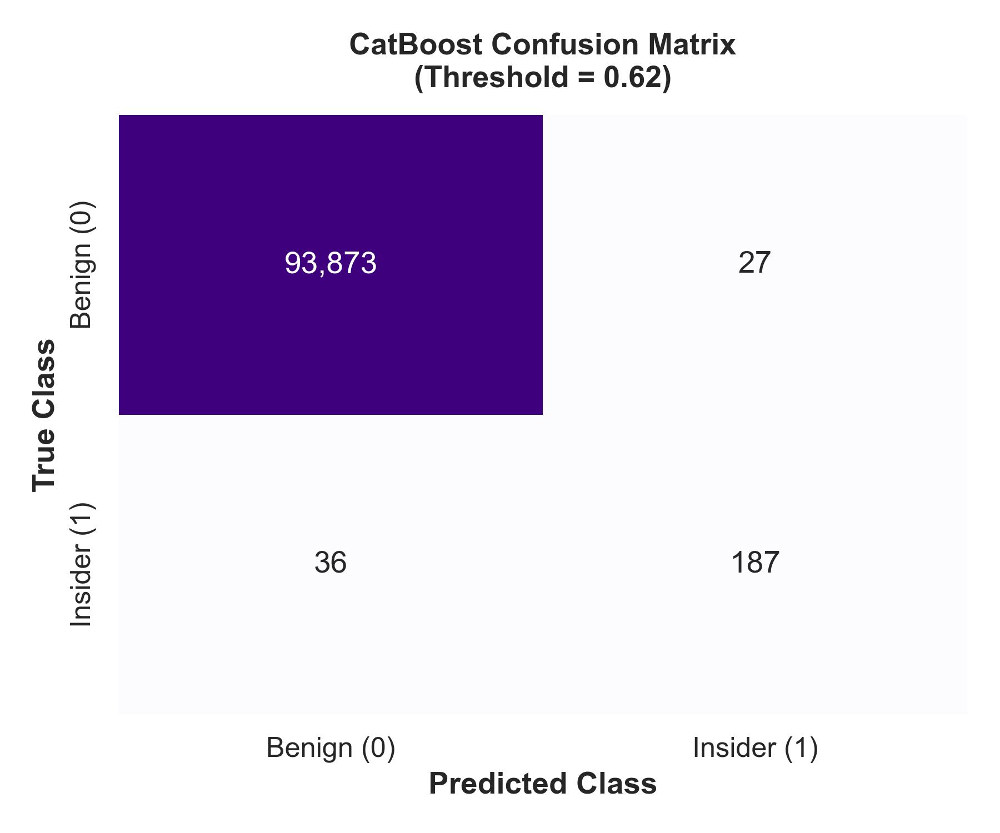 | 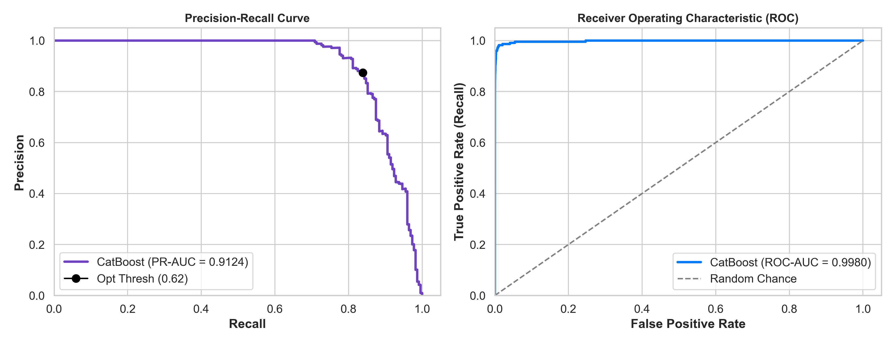 |
| *187 threats intercepted, 27 false alarms.* | *Smooth calibration from symmetric oblivious trees.* |

#### CatBoost Top 20 Behavioral Feature Importances
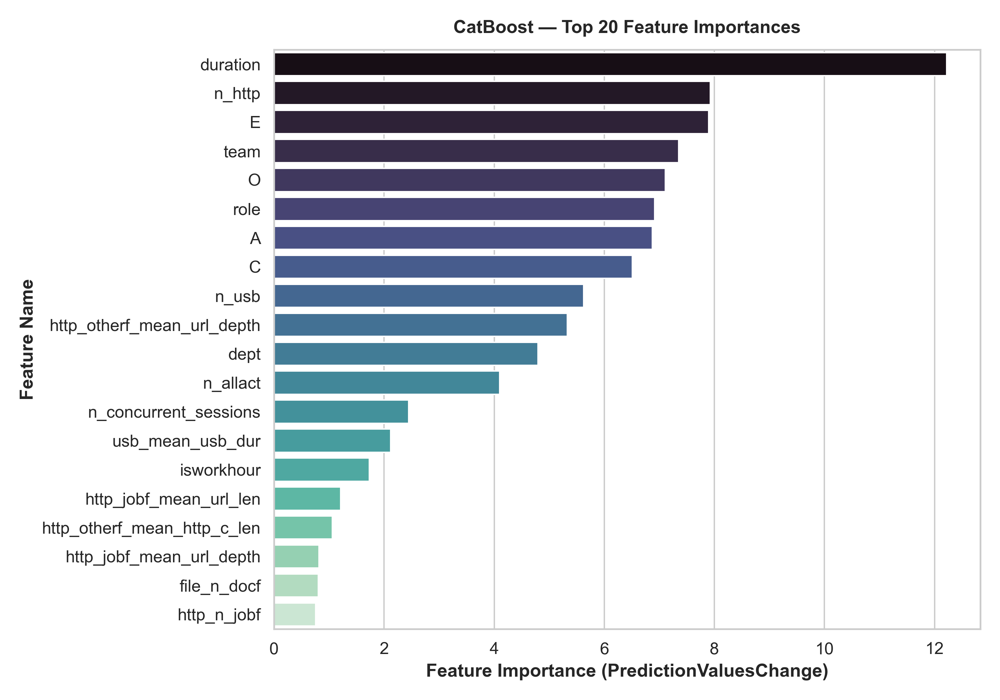

---

### 4. Model 1 — Random Forest (Bagging Variance Anchor)

Random Forest provided variance reduction across 200 bagging trees:

| Random Forest Confusion Matrix ($T^* = 0.22$) | Random Forest PR & ROC Curves (PR-AUC = 0.8086) |
| :---: | :---: |
| 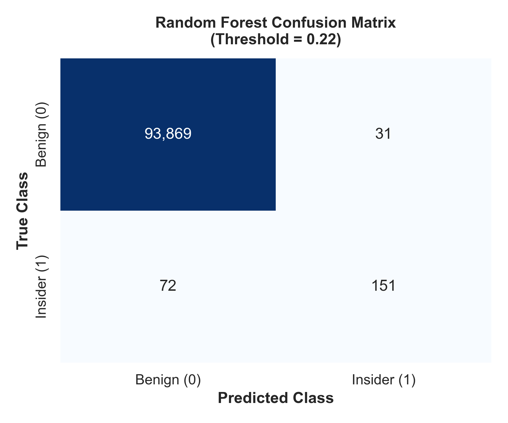 | 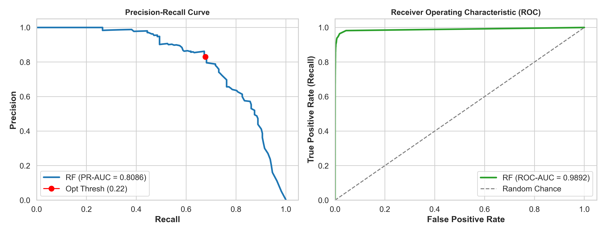 |
| *151 threats detected, 31 false alarms.* | *Cost-sensitive class weighting (balanced_subsample).* |

#### Random Forest Top 20 Gini Impurity Feature Importances
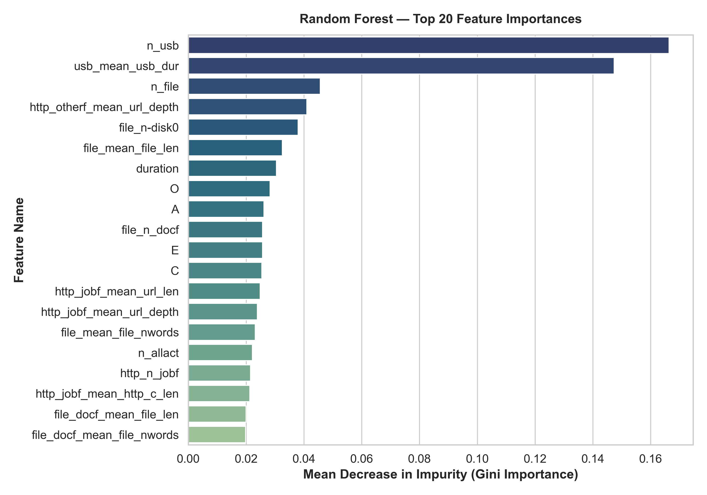

---

## 🖥️ Executive SOC Frontend Dashboard & Live Simulator

An executive Security Operations Center (SOC) dashboard is integrated in [`frontend/`](frontend) using **Next.js 16 (App Router)**, **TypeScript**, **Tailwind CSS v4**, and **Recharts**.

```
frontend/
├── src/
│   ├── app/
│   │   ├── page.tsx               # / (Command Center & Executive KPI Summary)
│   │   ├── methodology/page.tsx   # /methodology (5-Stage Architecture & SMOTE Comparison)
│   │   ├── results/page.tsx       # /results (Interactive Leaderboard & Plot Lightbox)
│   │   ├── features/page.tsx      # /features (Top 50 Signals & ANOVA+MI Table)
│   │   ├── simulator/page.tsx     # /simulator (Interactive Live Threat Simulator)
│   │   └── api/simulate/route.ts  # /api/simulate (Microservice Proxy + Fallback Engine)
│   ├── components/
│   │   ├── Navbar.tsx             # Navigation + Multi-Dataset Toggle (r4.2 vs r5.2)
│   │   └── Footer.tsx             # Academic Attribution & Links
│   └── data/
│       └── r4_2_metrics.json      # Structured benchmark metrics & feature stats
```

### Dashboard Core Capabilities:
1. **Multi-Dataset Header Switcher**: Seamlessly toggle between `CMU CERT r4.2 [Active]` and `CMU CERT r5.2 [Plug-in Ready]` to review new dataset benchmarks as they arrive.
2. **Interactive Threshold Leaderboard (`/results`)**: Toggle between optimal threshold $T^*$ and default threshold $0.50$ with instant recalculation.
3. **Full-Resolution Lightbox Inspector (`/results`)**: Click any plot to zoom into 300 DPI high-resolution publication charts.
4. **Interactive Feature Explorer (`/features`)**: Search, filter by domain (*Removable Media*, *Data Leak Sites*, *Job Hunting*, *File Exfiltration*, *Hacking*, *OCEAN*), and inspect ANOVA F and Mutual Information scores.
5. **Live Threat Simulator (`/simulator`)**: Adjust session behavioral sliders or trigger one-click attack scenario presets (*USB Exfiltration*, *Cloud Leak*, *Admin Recon*) to compute real-time threat probabilities, base model risk vectors, and recommended SOC actions.

---

## 📁 Repository Directory Structure

```
.
├── prepared_data/                          # Leakage-free feature metadata & rankings
│   ├── selected_features.json              # Top 50 selected feature names
│   └── feature_rankings_all.csv            # Combined ANOVA F + Mutual Information scores
├── models/
│   └── results_log.json                    # Full JSON metrics log & hyperparameters
├── plots/                                  # High-resolution publication figures (300 DPI)
│   ├── ensemble/                           # Stacking ensemble comparison plots
│   │   ├── all_models_pr_roc_comparison.png
│   │   ├── ensemble_confusion_matrix.png
│   │   └── meta_learner_weights.png
│   ├── rf/                                 # Random Forest evaluation plots
│   ├── xgb/                                # XGBoost evaluation plots
│   └── cb/                                 # CatBoost evaluation plots
├── frontend/                               # Executive SOC Dashboard (Next.js 16 + Tailwind CSS)
│   ├── src/app/                            # App Router pages (/ , /methodology, /results, /features, /simulator)
│   ├── src/components/                     # Navigation, Dataset Switcher, and Footer components
│   ├── src/data/r4_2_metrics.json          # Formatted metrics, features, and scenario presets
│   └── public/plots/                       # Mirrored evaluation plots for web display
├── eda/                                    # Exploratory Data Analysis notebooks
│   ├── Session1.ipynb                      # Session duration & event distributions
│   ├── r4-2-logon-eda.ipynb                # Logon/logoff hourly trends
│   ├── devicerr4_2.ipynb                   # Removable device connection analysis
│   ├── 2Devicer4_2.ipynb                   # Follow-up device behavior
│   └── 3devicer4_2.ipynb                   # USB segmentation analysis
├── api_server.py                           # FastAPI real-time multi-model risk inference server
├── generate_frontend_data.py               # Exporter for dashboard metrics and distribution stats
├── fast_feature_extraction.py              # High-speed vectorized session extraction engine
├── feature_extraction.py                   # Reference single-threaded extraction script
├── data_prep.py                            # Leakage-free preprocessing, ANOVA+MI, and splitting
├── train_rf.py                             # Random Forest training, CV, and evaluation
├── train_xgb.py                            # XGBoost training, CV, and evaluation
├── train_cb.py                             # CatBoost training, CV, and evaluation
├── train_meta_learner.py                   # Out-of-fold stacking ensemble pipeline
├── meta_learner_tuning.py                  # Hyperparameter exploration script
├── code_final.ipynb                        # Comprehensive end-to-end Jupyter notebook
├── session_columns.json                    # Master schema of extracted session features
├── .gitignore                              # Clean GitHub exclusion rules
└── README.md                               # Project documentation
```

---

## 🚀 Quickstart & Reproducibility Guide

### 1. Environment Setup
Clone this repository and install the verified dependencies:
```bash
git clone https://github.com/ShahjahanVighio/FYP_1.git
cd FYP_1
pip install numpy pandas scipy scikit-learn xgboost catboost imbalanced-learn matplotlib seaborn pyarrow fastparquet duckdb tqdm joblib fastapi uvicorn
```

### 2. Data Preparation & Feature Selection
Run the leakage-free preprocessing pipeline to generate the 80/20 stratified splits and select the Top 50 features:
```bash
python data_prep.py
```

### 3. Train Individual Base Classifiers
Train and evaluate Random Forest, XGBoost, and CatBoost with 5-fold Stratified Cross-Validation:
```bash
# Model 1: Random Forest
python train_rf.py

# Model 2: XGBoost
python train_xgb.py

# Model 3: CatBoost
python train_cb.py
```

### 4. Train Stacking Ensemble Meta-Learner
Generate out-of-fold probability vectors, train candidate meta-learners, optimize decision thresholds, and evaluate on the untouched test partition:
```bash
python train_meta_learner.py
```

All metrics, confusion matrices, and ROC/PR plots will automatically populate inside `models/results_log.json` and `plots/`.

### 5. Launch the Executive SOC Dashboard & Live Simulator
Launch the real-time inference microservice (optional):
```bash
python api_server.py
```
> *Runs on `http://localhost:8000`.*

In another terminal, launch the Next.js frontend:
```bash
cd frontend
npm install
npm run dev
```
> *Open **[http://localhost:3000](http://localhost:3000)** in your browser.*

---

## 👥 Contributors & Acknowledgments

- **Final Year Project Team**: Department of Computer Science & Software Engineering
- **Reference Contributor**: Raghav Seth (Faculty of Engineering, University of Ottawa)
- **Dataset Reference**: Glasser, J., & Lindauer, B. (2013). *Bridging the gap: A pragmatic approach to generating insider threat synthetic data*. Carnegie Mellon University, Software Engineering Institute (SEI).

---

## 📜 Citation & License

This project is licensed for academic, educational, and research use under the terms outlined in [license.txt](license.txt).
