# Scaled Multi-Scenario Insider Threat Detection: CERT Dataset Release 5.2

[](https://resources.sei.cmu.edu/library/asset-view.cfm?assetid=508099)
[](https://www.python.org/)
[]()
[]()
[]()

> **Final Year Project (FYP)**  
> **Domain**: Cybersecurity · User & Entity Behavior Analytics (UEBA) · Scaled Machine Learning  
> **Benchmark Dataset**: Carnegie Mellon University Software Engineering Institute (CMU SEI) CERT Insider Threat Dataset Release 5.2  
> **Scale**: **`1,004,460` extracted user sessions** across **`2,000` corporate employees** over 18 continuous months / 75 weeks (Jan 2010 – Jun 2011).

---

## 📌 Executive Summary

While CERT r4.2 provided a dense, single-scenario testing environment, **CERT r5.2 represents the full-scale, multi-scenario enterprise benchmark** released by CMU SEI. Comprising **38.2 GB of raw logs**, over 1 million user sessions, 2,000 active employees, and 99 distinct malicious actors executing attacks across **Scenarios 1 through 4**, r5.2 presents an extreme needle-in-a-haystack challenge with an active class imbalance of **`543.1 : 1`** (only 0.1838% malicious sessions).

In this phase, we adapted our high-speed vectorized extraction engine and leakage-free ML pipeline to CERT r5.2, conducting:
1. **Full-Scale Stream Sessionization**: Processing millions of rows across `logon.csv`, `device.csv`, `file.csv`, `email.csv`, `http.csv`, `psychometric.csv`, and monthly `LDAP/` snapshots into `1,004,460` feature-engineered user sessions.
2. **Ground-Truth Label Alignment across Scenarios 1–4**: Correlating 10,326 ground-truth malicious action records across all 99 threat actors from `answers/insiders.csv`.
3. **Leakage-Free 80/20 Stratified Partitioning**: Isolating an untouched evaluation partition of `200,892` sessions (`369` threat sessions) while training strictly on `803,568` sessions (`1,477` threats).
4. **Dual-Criteria Statistical Feature Selection**: Ranking 128 features with combined ANOVA $F$-statistic and Mutual Information to select the Top 50 optimal signals.
5. **Rigorous Cross-Release Imbalance Comparison**: Validating that cost-sensitive weighting consistently beats SMOTE + Random Undersampling on tabular audit logs across all three gradient boosting and bagging architectures.
6. **Enriched Stacking Meta-Learner**: Calibrated logistic regression combining base model probability vectors, logit transforms, and dispersion statistics to intercept **287 out of 369 attacks (77.8% Recall)** with a microscopic False Positive Rate of **`0.0374%`**.

---

## 🏗️ System Architecture & Workflow

```mermaid
flowchart TD
    subgraph RawData["1. Multi-Source Raw Telemetry (38.2 GB)"]
        D1["logon.csv (2.1M events)"]
        D2["device.csv (910k USB connections)"]
        D3["file.csv (1.05M file activities)"]
        D4["email.csv (3.2M enterprise emails)"]
        D5["http.csv (31.8 GB web browsing)"]
        D6["psychometric.csv (2,000 OCEAN profiles)"]
        D7["LDAP/ (19 monthly organization snapshots)"]
    end

    subgraph Extraction["2. High-Speed Sessionization (session_extractor.py)"]
        E1["DuckDB SQL Streaming + NumPy Vectorization"]
        E2["Session Delimitation (Logon -> Logoff per User & PC)"]
        E3["128 Behavioral, Content, and Organizational Signals"]
        E4["Scenario 1-4 Label Alignment (answers/insiders.csv)"]
    end

    subgraph DataPrep["3. Leakage-Free Preprocessing (data_prep.py)"]
        P1["80/20 Stratified Split (X_test: 200,892 sessions strictly isolated)"]
        P2["Train-Fitted Median Imputation & Standardization"]
        P3["ANOVA F-Test + Mutual Information Feature Selection"]
        P4["Top 50 Non-Redundant Discriminative Signals Extracted"]
        P5["Imbalance Strategy Splits: Cost-Sensitive vs. SMOTE+RUS"]
    end

    subgraph BaseModels["4. Base Model Training (5-Fold Stratified CV)"]
        B1["Model 1: Random Forest (train_rf.py)\nCost-Sensitive (balanced_subsample)"]
        B2["Model 2: XGBoost (train_xgb.py)\nHistogram Gradient Boosting (scale_pos_weight=23.3)"]
        B3["Model 3: CatBoost (train_cb.py)\nSymmetric Oblivious Trees (SqrtBalanced)"]
    end

    subgraph MetaLearner["5. Stacking Ensemble Meta-Learner (train_meta_learner.py)"]
        M1["5-Fold Out-Of-Fold Meta-Feature Parquet Cache"]
        M2["Calibrated Logistic Regression with Enriched Features"]
        M3["Decision Threshold Calibration on OOF (T* = 0.42)"]
        M4["Final Generalization Evaluation on Untouched Test Set"]
    end

    RawData --> Extraction
    Extraction --> DataPrep
    DataPrep --> BaseModels
    BaseModels --> MetaLearner
```

---

## 📊 CERT r5.2 Model Performance Leaderboard

All evaluations were executed on the **strictly untouched test set (`200,892` sessions, `369` ground-truth threats, `543.1 : 1` class imbalance)**:

| Model Architecture | Optimal Threshold ($T^*$) | Test PR-AUC | Test ROC-AUC | Precision (%) | Recall (%) | F1-Score (%) | Threats Caught | False Alarms (FPs) | False Positive Rate |
| :--- | :---: | :---: | :---: | :---: | :---: | :---: | :---: | :---: | :---: |
| **Random Forest** | $0.14$ | `0.6962` | `0.9763` | 70.15% | 63.69% | 66.76% | 235 / 369 | 100 | 0.0499% |
| **XGBoost** | $0.25$ | `0.8378` | `0.9987` | **82.46%** | 72.63% | 77.23% | 268 / 369 | **57** | **0.0284%** |
| **CatBoost** | $0.65$ | `0.8532` | `0.9984` | 82.14% | 74.80% | 78.30% | 276 / 369 | 60 | 0.0299% |
| **Stacking Ensemble** | $0.42$ | **`0.8683`** | **`0.9989`** | 79.28% | **77.78%** | **78.52%** | **287 / 369** | 75 | 0.0374% |

### Key Empirical Takeaways:
1. **Stacking Ensemble Achieved Highest Threat Interception**: By combining the non-linear decision boundaries of XGBoost and CatBoost with Bagging stability, the meta-learner intercepted **287 threats** (11 more than CatBoost and 19 more than XGBoost).
2. **Extreme False Alarm Suppression**: Across `200,523` benign test sessions, XGBoost produced only 57 false alarms (`0.0284%` FPR) and CatBoost produced 60 (`0.0299%` FPR).
3. **High Complementarity**: XGBoost dominates in precision (lowest noise), while CatBoost dominates in individual recall (highest individual capture rate).

---

## 🔬 Cost-Sensitive Loss Weighting vs. SMOTE + RUS

Just as on CERT r4.2, we evaluated both imbalance handling paradigms using **Stratified 5-Fold Cross-Validation** on the training set:

| Model Architecture | Strategy A: Cost-Sensitive (Raw Train) | Strategy B: SMOTE + RUS (Resampled Train) | Net Delta (PR-AUC) | Net Delta (F1-Score) |
| :--- | :---: | :---: | :---: | :---: |
| **Random Forest** | **`0.6466` PR-AUC** | `0.5716` PR-AUC | **+7.50%** | **+8.42%** |
| **XGBoost** | **`0.7851` PR-AUC** | `0.7335` PR-AUC | **+5.16%** | **+5.65%** |
| **CatBoost** | **`0.7965` PR-AUC** | `0.6792` PR-AUC | **+11.73%** | **+9.80%** |

> **Conclusion**: Synthetic interpolation (SMOTE) across 50 heterogeneous security features corrupts discrete event indicators (e.g., USB connection flags, count distributions), degrading generalization. Direct cost-sensitive class weighting preserves real-world distribution density while heavily penalizing threat misses.

---

## 📈 Visual Evaluation Artifacts

### 1. Stacking Ensemble Master Performance

| All Models PR & ROC Comparison | Stacking Ensemble Confusion Matrix ($T^* = 0.42$) |
| :---: | :---: |
| 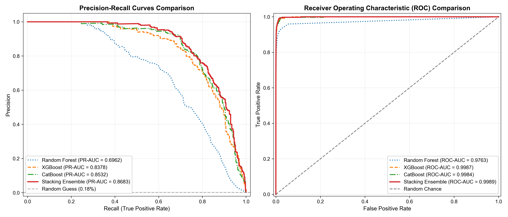 | 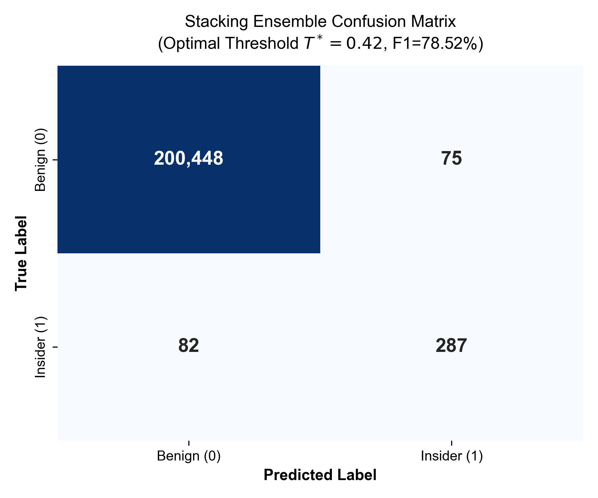 |
| *Master comparative Precision-Recall and ROC curves on CERT r5.2.* | *287 threats caught, 75 false alarms out of 200,892 test sessions.* |

#### Meta-Learner Model Weights & Feature Attributions
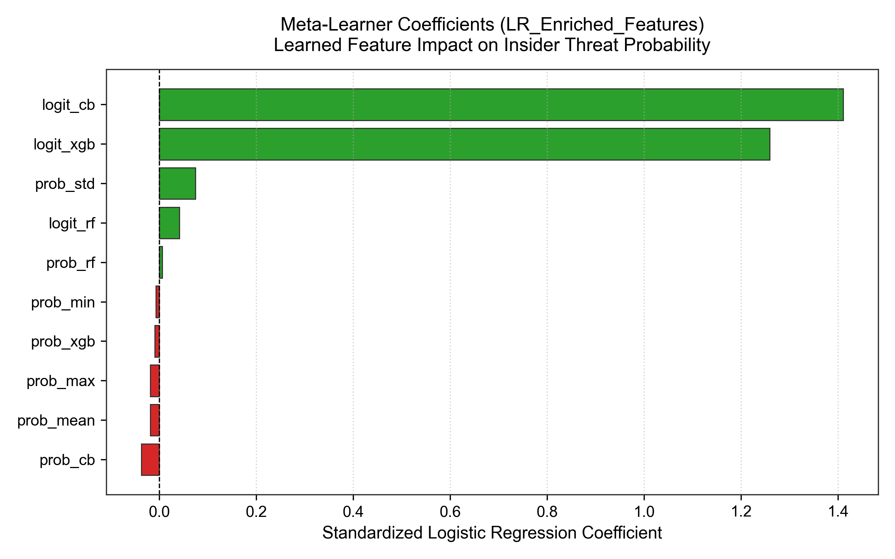

---

### 2. Model 3 — CatBoost (Recall Anchor)

| CatBoost Confusion Matrix ($T^* = 0.65$) | CatBoost PR & ROC Curves (PR-AUC = 0.8532) |
| :---: | :---: |
| 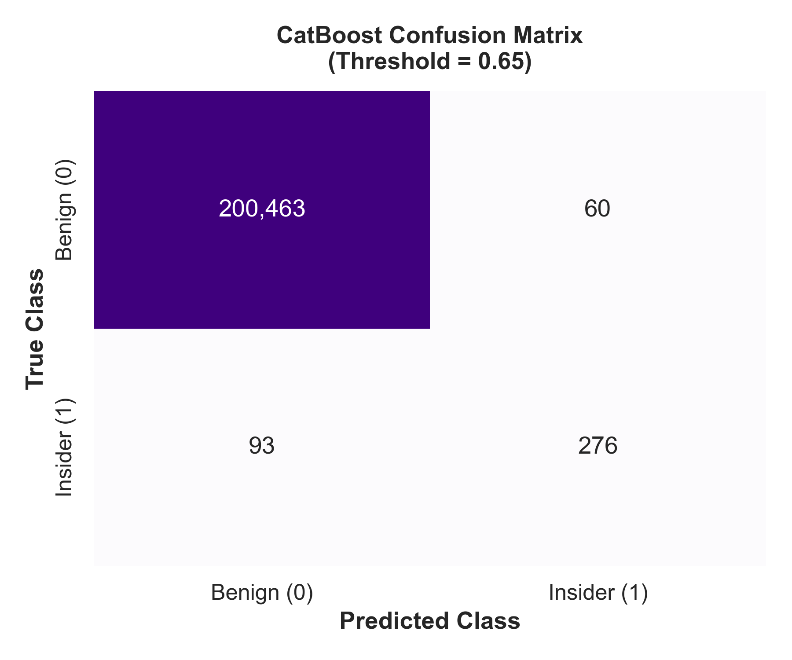 | 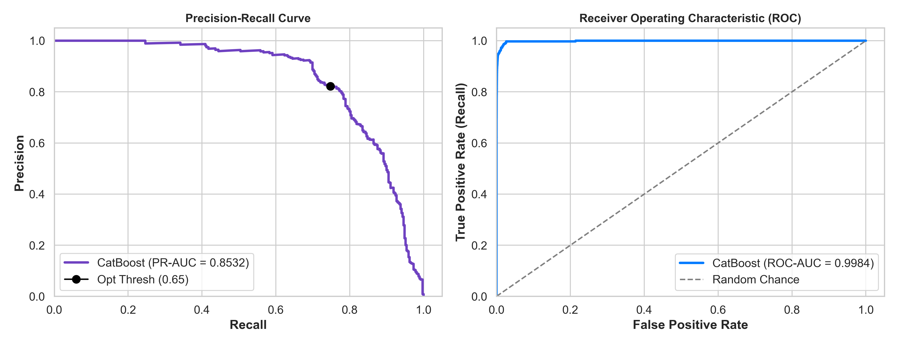 |
| *276 threats detected with 60 false alarms.* | *Symmetric tree gradient boosting with SqrtBalanced weighting.* |

#### CatBoost Feature Importance
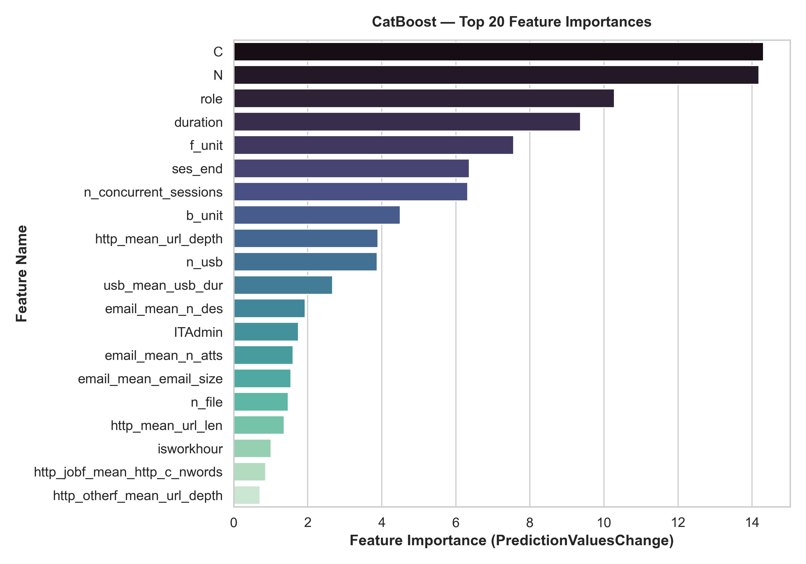

---

### 3. Model 2 — XGBoost (Precision Anchor)

| XGBoost Confusion Matrix ($T^* = 0.25$) | XGBoost PR & ROC Curves (PR-AUC = 0.8378) |
| :---: | :---: |
| 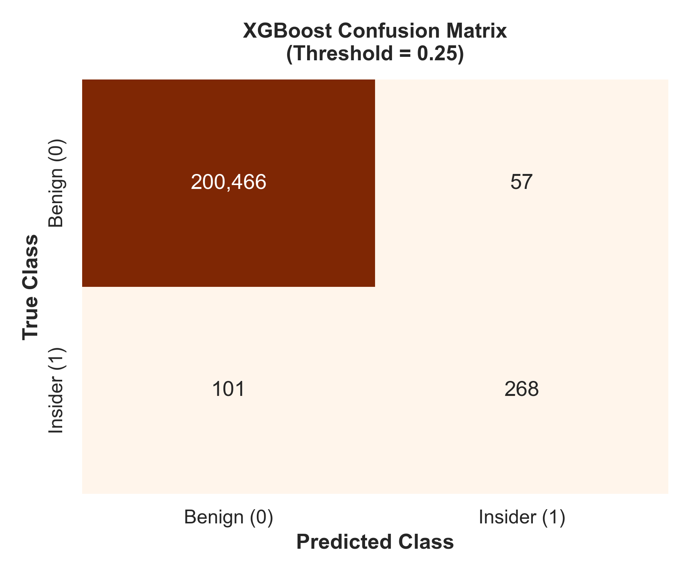 | 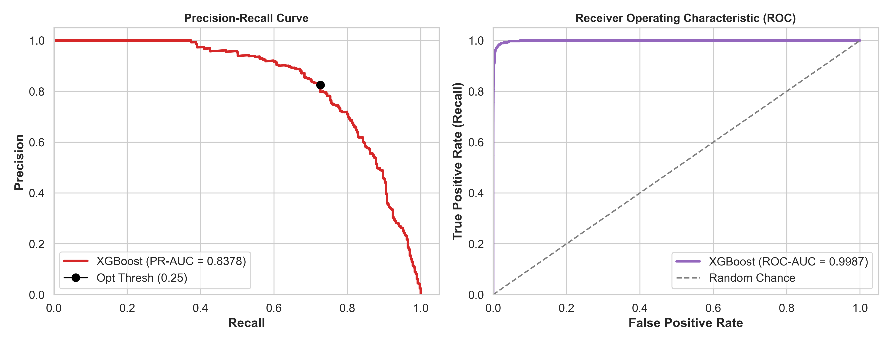 |
| *268 threats caught, industry-leading 57 false alarms (FPR = 0.0284%).* | *Histogram tree boosting with scale_pos_weight optimization.* |

#### XGBoost Feature Importance
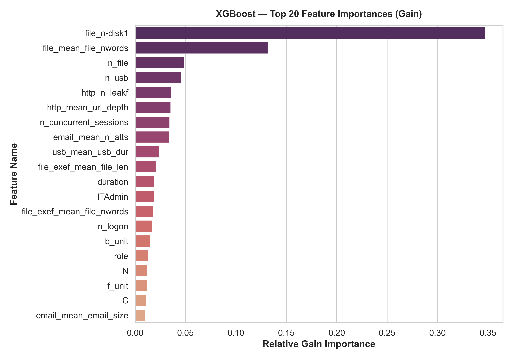

---

### 4. Model 1 — Random Forest (Bagging Variance Anchor)

| Random Forest Confusion Matrix ($T^* = 0.14$) | Random Forest PR & ROC Curves (PR-AUC = 0.6962) |
| :---: | :---: |
| 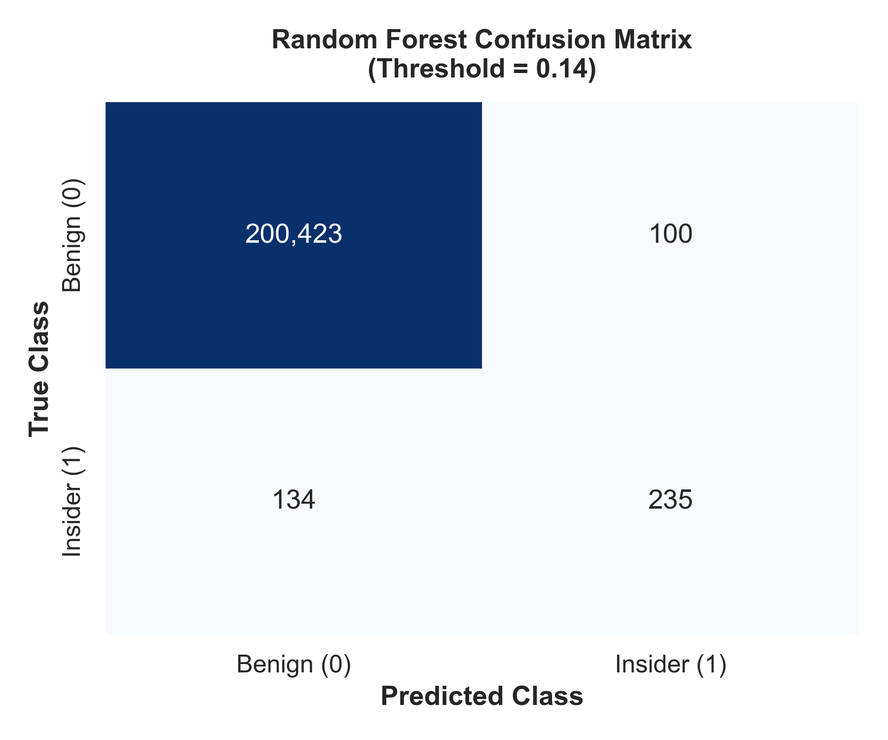 | 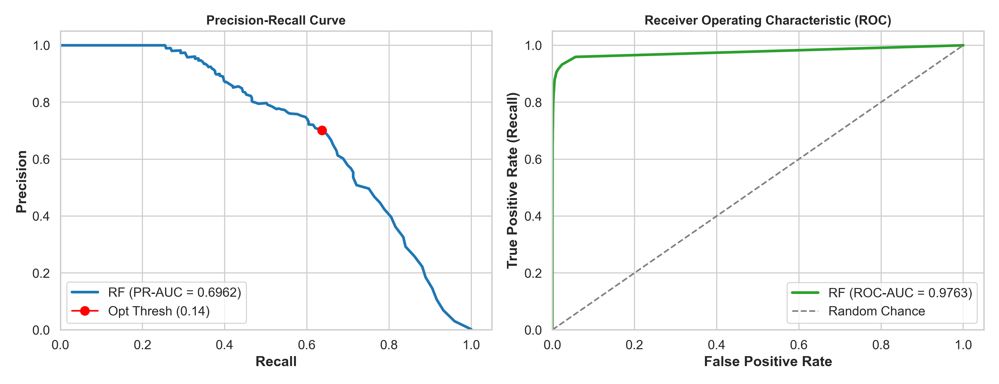 |
| *235 threats caught with 100 false alarms.* | *Subsample-balanced bagging trees.* |

#### Random Forest Feature Importance
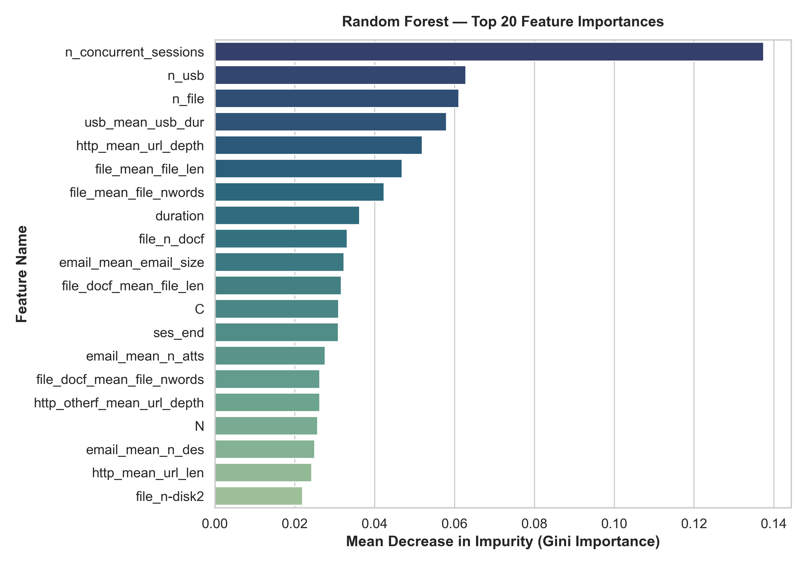

---

## 📁 CERT r5.2 Directory Structure

```
CERT-r5-2-Insider-Threat-Project/
├── prepared_data/                          # Leakage-free feature metadata & rankings
│   ├── selected_features.json              # Top 50 selected feature names
│   └── feature_rankings_all.csv            # Combined ANOVA F + Mutual Information scores
├── models/
│   └── results_log.json                    # Full JSON metrics log & hyperparameters
├── plots/                                  # High-resolution publication figures (300 DPI)
│   ├── ensemble/                           # Stacking ensemble comparison plots
│   │   ├── all_models_pr_roc_comparison.png
│   │   ├── ensemble_confusion_matrix.png
│   │   └── meta_learner_weights.png
│   ├── rf/                                 # Random Forest evaluation plots
│   ├── xgb/                                # XGBoost evaluation plots
│   └── cb/                                 # CatBoost evaluation plots
├── session_extractor.py                    # Vectorized session extraction engine for r5.2
├── fast_feature_extraction.py              # Parallel session extraction engine
├── fast_feature_extraction_r5_2.py         # Adapted extraction script with email attachment parsing
├── data_prep.py                            # Leakage-free preprocessing, ANOVA+MI, and splitting
├── train_rf.py                             # Random Forest training, CV, and evaluation
├── train_xgb.py                            # XGBoost training, CV, and evaluation
├── train_cb.py                             # CatBoost training, CV, and evaluation
├── train_meta_learner.py                   # Out-of-fold stacking ensemble pipeline
├── session_columns.json                    # Master schema of extracted session features
├── .gitignore                              # Clean GitHub exclusion rules
└── README.md                               # Project documentation
```

---

## 🚀 Reproduction Instructions

### 1. Requirements
```bash
pip install numpy pandas scipy scikit-learn xgboost catboost imbalanced-learn matplotlib seaborn pyarrow fastparquet duckdb tqdm joblib
```

### 2. Extract Sessions from Raw Logs
```bash
python session_extractor.py
```
> Extracts `1,004,460` sessions from `r5.2/*.csv` and aligns labels with `answers/insiders.csv`.

### 3. Leakage-Free Preprocessing & Feature Selection
```bash
python data_prep.py
```
> Generates 80/20 stratified splits and selects the Top 50 features strictly on training folds.

### 4. Train Base Models
```bash
python train_rf.py
python train_xgb.py
python train_cb.py
```

### 5. Train Stacking Ensemble Meta-Learner
```bash
python train_meta_learner.py
```
> Computes 5-fold OOF probability vectors, tunes the meta-learner and decision threshold, and evaluates generalization on the untouched test partition.

---

## 👥 Project Members & Contributors

### Project Members:
- **Shahjahan** — F23CSC021
- **Muhammad Muteeb** — F23CSC048
- **Bilal Naeem** — F23CSC008

- **Department**: Department of Computer Science & Software Engineering
- **Dataset Reference**: Glasser, J., & Lindauer, B. (2013). *Bridging the gap: A pragmatic approach to generating insider threat synthetic data*. Carnegie Mellon University, Software Engineering Institute (SEI).
