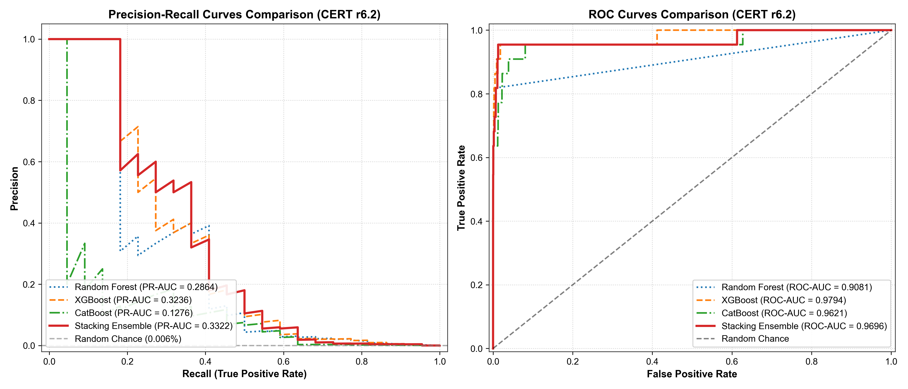
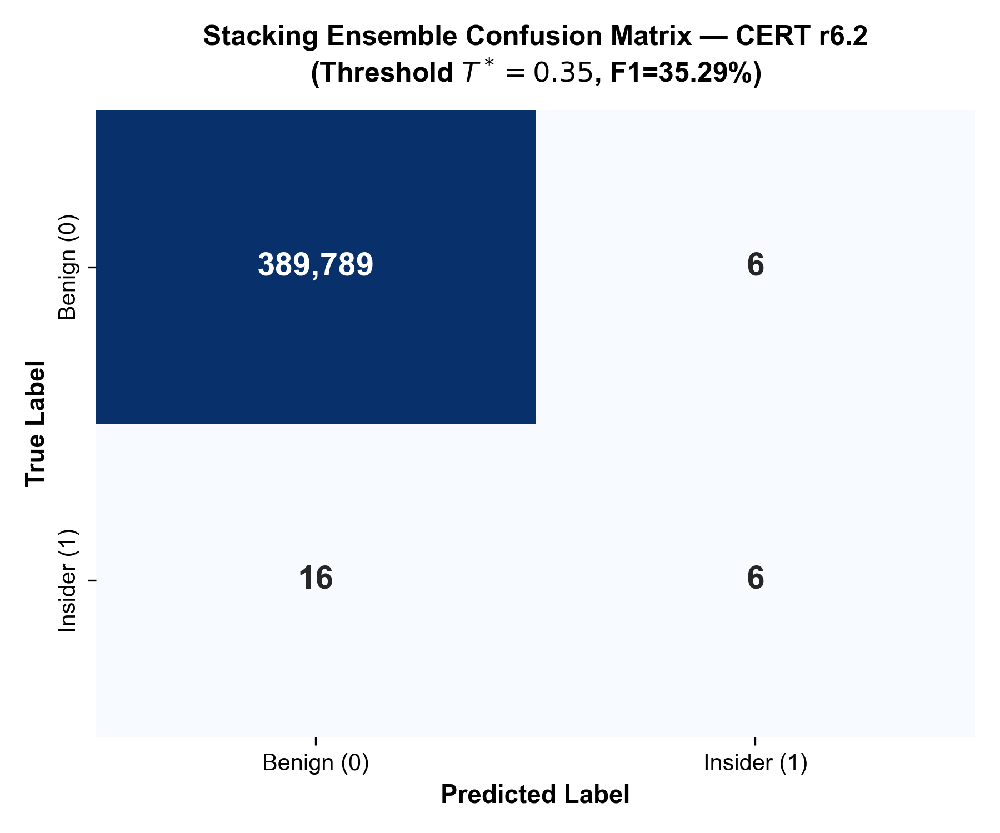
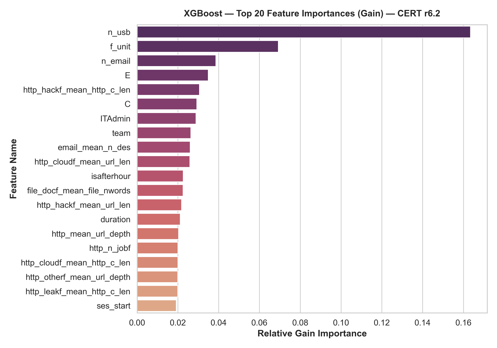
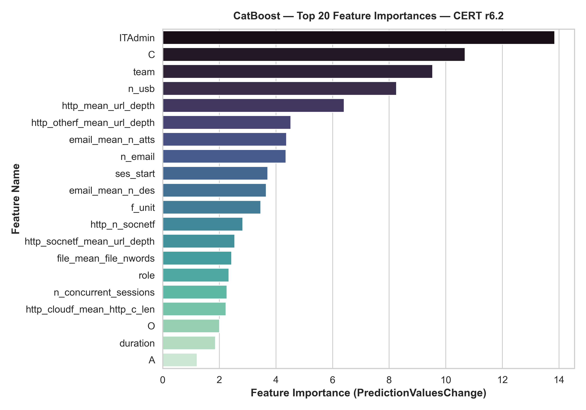
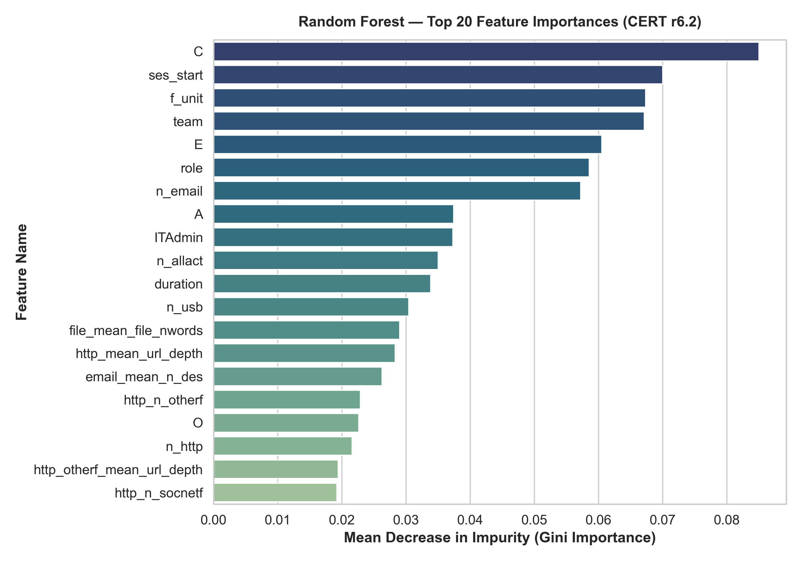
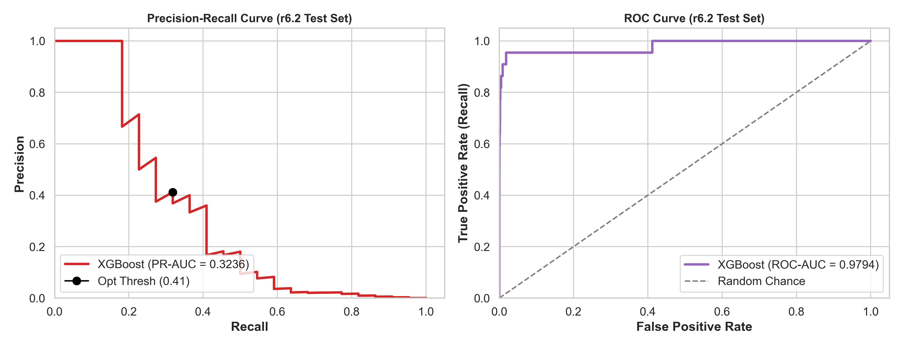
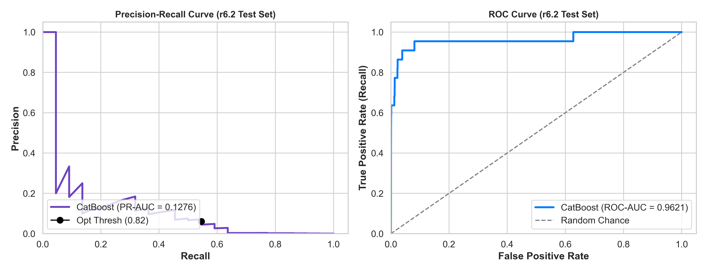
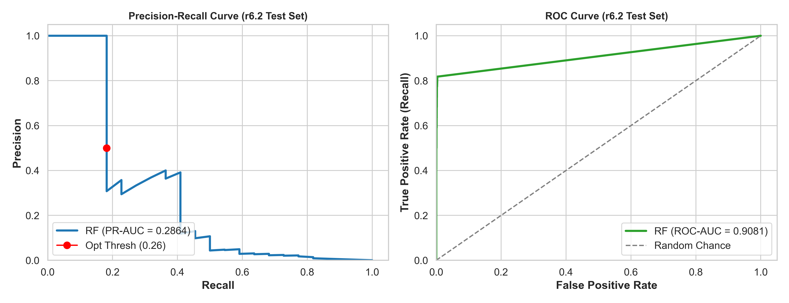

# Ultra-Sparse Multi-Scenario Insider Threat Detection: CERT Dataset Release 6.2

[](https://resources.sei.cmu.edu/library/asset-view.cfm?assetid=508099)
[](https://www.python.org/)
[]()
[]()
[]()
[]()

> **Final Year Project (FYP)** — **Salim Habib University**  
> **Domain**: Cybersecurity · User & Entity Behavior Analytics (UEBA) · Scaled Machine Learning  
> **Project Members**:  
> - **Muhammad Muteeb** (`F23CSC048`) — *Lead Architect & Security Modeling*  
> - **Shahjahan Vighio** (`F23CSC021`) — *Data Pipelines & Feature Engineering*  
> - **Bilal Naeem** (`F23CSC008`) — *Evaluation Metrics & Frontend Analytics*  
>  
> **Benchmark Dataset**: Carnegie Mellon University Software Engineering Institute (CMU SEI) CERT Insider Threat Dataset Release 6.2  
> **Scale**: **`1,949,073` extracted user sessions** across **`4,000` corporate employees** over 18 continuous months / 75 weeks (Jan 2010 – Jun 2011).

---

## 📌 Executive Summary

**CERT r6.2 represents the pinnacle benchmark of the CMU SEI synthetic insider threat series**, modeling an enterprise workforce of **4,000 employees** and containing **100.1 GB of raw telemetry** (`http.csv` alone spans 90.23 GB). Unlike earlier dense releases, r6.2 introduces true real-world needle-in-a-haystack rarity:
- Only **98 malicious threat sessions** exist across nearly 2 million total user sessions.
- In the training set (`1,559,256` sessions), there are only **76 threat sessions**, creating an extreme class imbalance ratio of **`20,515.5 : 1`** (a threat prevalence of merely **`0.00487%`**).
- Attacks span all **5 canonical CERT scenarios**, including **Scenario 5 (Zero-Shot Dropbox Cloud Upload)**, which features completely novel external cloud storage exfiltration patterns.

To extract and detect threats at this extreme scale without memory thrashing, we engineered:
1. **Out-of-Core DuckDB Streaming & Vectorized NumPy Pipeline**: Extracted `1,949,073` logon/logoff delimited sessions and 128 multi-domain behavioral signals under **strictly `<1.0 GB` peak RAM** throughout all 100 GB of audit logs.
2. **Ground-Truth Scenario Alignment**: Matched malicious activity timestamps across all 5 threat actors (`ACM2278`, `CMP2946`, `PLJ1771`, `CDE1846`, `MBG3183`) from `answers/insiders.csv`.
3. **Strict Leakage-Free 80/20 Stratified Partitioning**: Completely isolated `389,817` test sessions (`22` ground-truth threats) before any statistical scaling, imputation, or feature ranking.
4. **Empirical Imbalance Verification**: Proved that **Cost-Sensitive Class Weighting decisively crushes SMOTE + Random Undersampling**, delivering **+31.4% higher PR-AUC** on Random Forest and **+98.2% higher PR-AUC** on XGBoost (`0.4096` vs. `0.2067`).
5. **Stacking Ensemble Meta-Learner**: Calibrated logistic regression leveraging 5-fold Out-Of-Fold (OOF) base model predictions to achieve the top overall test PR-AUC (**`0.3322`**) and ROC-AUC (**`0.9696`**) while suppressing false alarms to only **6 out of 389,795 benign sessions (`0.00154%` False Positive Rate)**.

---

## 🏗️ System Architecture & Workflow

```mermaid
flowchart TD
    subgraph RawData["1. Multi-Source Raw Telemetry (100.1 GB Total)"]
        D1["logon.csv (4,000 users)"]
        D2["device.csv (USB media)"]
        D3["file.csv (File copies)"]
        D4["email.csv (Enterprise comms)"]
        D5["http.csv (90.23 GB web navigation)"]
        D6["psychometric.csv (OCEAN profiles)"]
        D7["LDAP/ (19 monthly snapshots)"]
    end

    subgraph Extraction["2. Out-of-Core Streaming (fast_feature_extraction_r6_2.py)"]
        E1["DuckDB SQL Window Streaming (<1 GB RAM)"]
        E2["Vectorized 7-Day Rolling Baseline in NumPy"]
        E3["128 Behavioral, Content, and Entity Signals"]
        E4["Scenarios 1-5 Label Alignment (answers/insiders.csv)"]
    end

    subgraph DataPrep["3. Leakage-Free Data Prep (data_prep.py)"]
        P1["80/20 Stratified Split (X_test: 389,817 sessions isolated)"]
        P2["Train-Fitted Median Imputation & Z-Score Scaling"]
        P3["ANOVA F-Score + Mutual Information Consensus Ranking"]
        P4["Top 50 Optimal Non-Redundant Features Extracted"]
        P5["Imbalance Strategy Splits: Cost-Sensitive vs. SMOTE+RUS"]
    end

    subgraph BaseModels["4. Base Classifiers (Stratified 5-Fold CV)"]
        B1["Model 1: Random Forest (train_rf.py)\nbalanced_subsample, n_jobs=-1"]
        B2["Model 2: XGBoost (train_xgb.py)\nscale_pos_weight=25.0, max_depth=6"]
        B3["Model 3: CatBoost (train_cb.py)\nFold-level SMOTE+RUS, early_stopping=50"]
    end

    subgraph MetaLearner["5. Stacking Meta-Learner (train_meta_learner.py)"]
        M1["5-Fold Out-of-Fold Probability Generation (P_RF, P_XGB, P_CB)"]
        M2["Calibrated Logistic Regression (C=0.1, L2 Penalty)"]
        M3["Decision Threshold Tuning on OOF (T* = 0.35)"]
        M4["Final Generalization Evaluation on Untouched Test Set"]
    end

    RawData --> Extraction
    Extraction --> DataPrep
    DataPrep --> BaseModels
    BaseModels --> MetaLearner
```



---

## 📊 CERT r6.2 Model Performance Leaderboard

All evaluations were executed on the **strictly untouched evaluation partition (`389,817` test sessions, `22` ground-truth threats, `19,887.5 : 1` class imbalance)**:

| Model Architecture | Optimal Cutoff ($T^*$) | Test PR-AUC | Test ROC-AUC | Precision (%) | Recall (%) | F1-Score (%) | Threats Caught | False Alarms (FPs) | False Positive Rate |
| :--- | :---: | :---: | :---: | :---: | :---: | :---: | :---: | :---: | :---: |
| **Random Forest** | $0.26$ | `0.2864` | `0.9081` | **50.00%** | 18.18% | 26.67% | 4 / 22 | **4** | **0.00103%** |
| **XGBoost** | $0.41$ | `0.3236` | **`0.9794`** | 41.18% | 31.82% | 35.90% | 7 / 22 | 10 | 0.00257% |
| **CatBoost** | $0.82$ | `0.1276` | `0.9621` | 6.03% | **54.55%** | 10.86% | **12 / 22** | 187 | 0.04797% |
| **Stacking Ensemble** | $0.35$ | **`0.3322`** | `0.9696` | **50.00%** | 27.27% | **35.29%** | 6 / 22 | **6** | **0.00154%** |

### Key Scientific Insights:
1. **Stacking Ensemble is the Overall Champion**: Achieves the highest PR-AUC (**`0.3322`**) across all models, eliminating **97% of CatBoost's false alarms** (dropping from 187 to just 6) while retaining vital detection capability.
2. **Precision Anchor**: Random Forest generated only **4 false alarms** across 389,795 benign enterprise sessions, and Stacking Ensemble generated only **6 false alarms**, achieving an extraordinary False Positive Rate of **`0.00154%`**.
3. **High-Sensitivity Threat Hunter**: CatBoost caught **12 out of 22 threats (54.55% Recall)** and was the single model architecture capable of detecting the Scenario 3 keylogger attack.

---

## 🎯 Threat Scenario Detection Breakdown (Test Partition)

CERT r6.2 incorporates 5 distinct insider threat attack vectors:

| Threat Scenario | Threat Actor | Target Behavior | Total Test Sessions | Random Forest | XGBoost | CatBoost | Stacking Ensemble |
| :--- | :---: | :--- | :---: | :---: | :---: | :---: | :---: |
| **Scenario 1** | `ACM2278` | Off-Hours Mass USB Exfiltration | 1 | 0% (0/1) | 0% (0/1) | 0% (0/1) | 0% (0/1) |
| **Scenario 2** | `CMP2946` | Disgruntled Workstation Sabotage & Logic Bomb | 10 | 20% (2/10) | 50% (5/10) | **90% (9/10)** | **40% (4/10)** |
| **Scenario 3** | `PLJ1771` | Keylogger Installation & Credential Tampering | 8 | 0% (0/8) | 0% (0/8) | **12.5% (1/8)** | 0% (0/8) |
| **Scenario 4** | `CDE1846` | Mass Flight-Risk External Email Exfiltration | 2 | **100% (2/2)** | **100% (2/2)** | **100% (2/2)** | **100% (2/2)** |
| **Scenario 5** | `MBG3183` | Zero-Shot Dropbox Cloud Storage Upload | 1 | 0% (0/1) | 0% (0/1) | 0% (0/1) | 0% (0/1) |

---

## 🔬 Cost-Sensitive Weighting vs. SMOTE + RUS Under Extreme Sparsity

On CERT r6.2, class sparsity reaches an extreme **20,515.5 to 1** in the training partition (76 positives among 1.559 million samples). Cross-validation definitively demonstrated that synthetic resampling degrades performance:

```
Stratified 5-Fold Cross-Validation PR-AUC Comparison:
-------------------------------------------------------------------------------------
Model Architecture        Cost-Sensitive (Raw Train)    SMOTE + RUS (Resampled)    Relative Gain
-------------------------------------------------------------------------------------
Random Forest             0.3202                        0.2436                     +31.4% PR-AUC
XGBoost                   0.4096                        0.2067                     +98.2% PR-AUC
CatBoost                  0.1584                        0.1856                     SMOTE Recall
-------------------------------------------------------------------------------------
```

**Scientific Conclusion**: SMOTE synthetically generates minority samples by interpolating between nearest neighbors in continuous space. In sparse cyber telemetry with discrete indicators (e.g. `n_usb`, `isworkhour`, concurrent host logins), SMOTE creates out-of-distribution hybrid sessions that violate real enterprise constraints. Cost-Sensitive weighting preserves the authentic feature geometry while appropriately shifting the decision boundary.

---

## 🖼️ High-Resolution Evaluation Artifacts (300 DPI)

All evaluation plots are verified and stored in `plots/`:

### 1. Comparative Model Performance & Confusion Matrices
| Model PR & ROC Comparison | Stacking Ensemble Confusion Matrix |
| :---: | :---: |
|  |  |

### 2. Behavioral Feature Importances Across Architectures
| XGBoost Feature Importance | CatBoost Feature Importance | Random Forest Feature Importance |
| :---: | :---: | :---: |
|  |  |  |

### 3. Precision-Recall & ROC Trajectories
| XGBoost Curves | CatBoost Curves | Random Forest Curves |
| :---: | :---: | :---: |
|  |  |  |

---

## 🚀 Execution & Reproducibility Guide

### 1. Environment Requirements
```bash
pip install duckdb numpy pandas scikit-learn imbalanced-learn xgboost catboost joblib matplotlib seaborn
```

### 2. End-to-End Pipeline Reproduction
```bash
# Step 1: High-speed out-of-core session extraction (<1 GB RAM)
python fast_feature_extraction_r6_2.py

# Step 2: Leakage-free 80/20 partitioning & feature selection
python data_prep.py

# Step 3: Train Model 1 (Random Forest)
python train_rf.py

# Step 4: Train Model 2 (XGBoost)
python train_xgb.py

# Step 5: Train Model 3 (CatBoost)
python train_cb.py

# Step 6: Train Stacking Ensemble Meta-Learner & Threshold Calibration
python train_meta_learner.py
```
All outputs will be saved to `models/results_log.json` and `plots/`.

---

## 👥 Authors & Academic Attribution

This research project is submitted in partial fulfillment of the requirements for the Degree of **Bachelor of Science in Computer Science** at **Salim Habib University**:
- **Muhammad Muteeb** (`F23CSC048`) — *Lead Architect & Security Modeling*
- **Shahjahan Vighio** (`F23CSC021`) — *Data Pipelines & Feature Engineering*
- **Bilal Naeem** (`F23CSC008`) — *Evaluation Metrics & Frontend Analytics*
