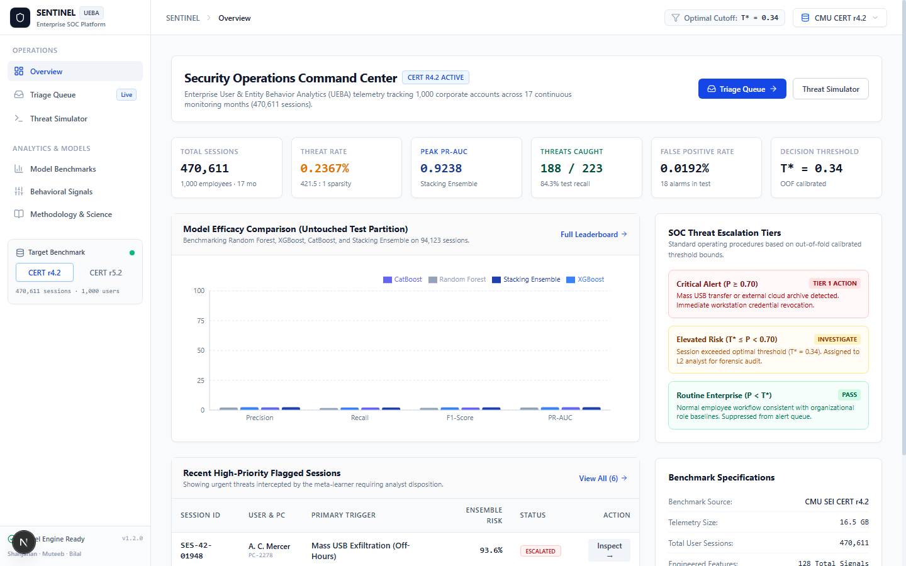
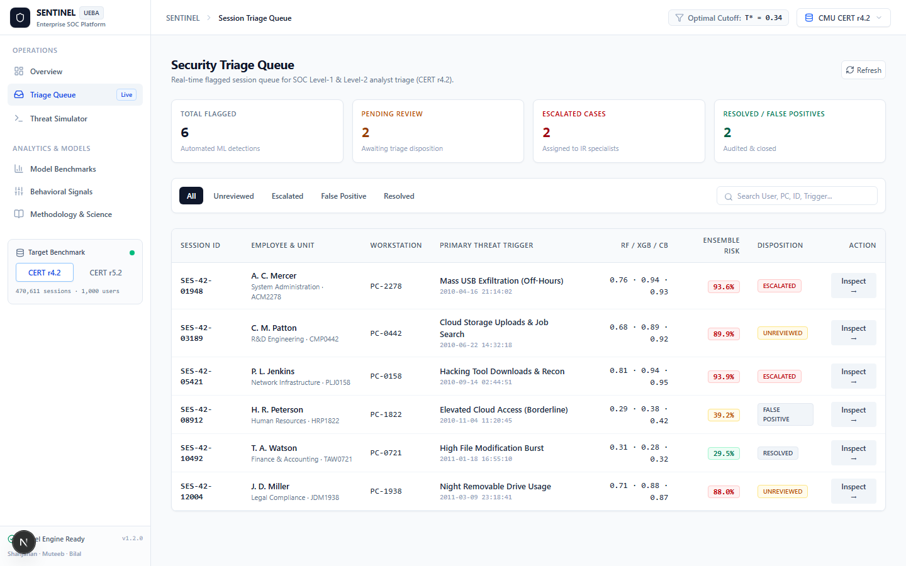
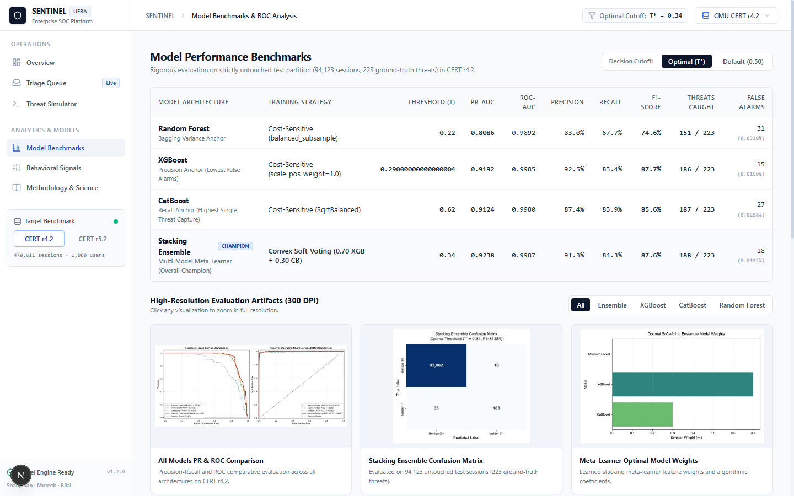
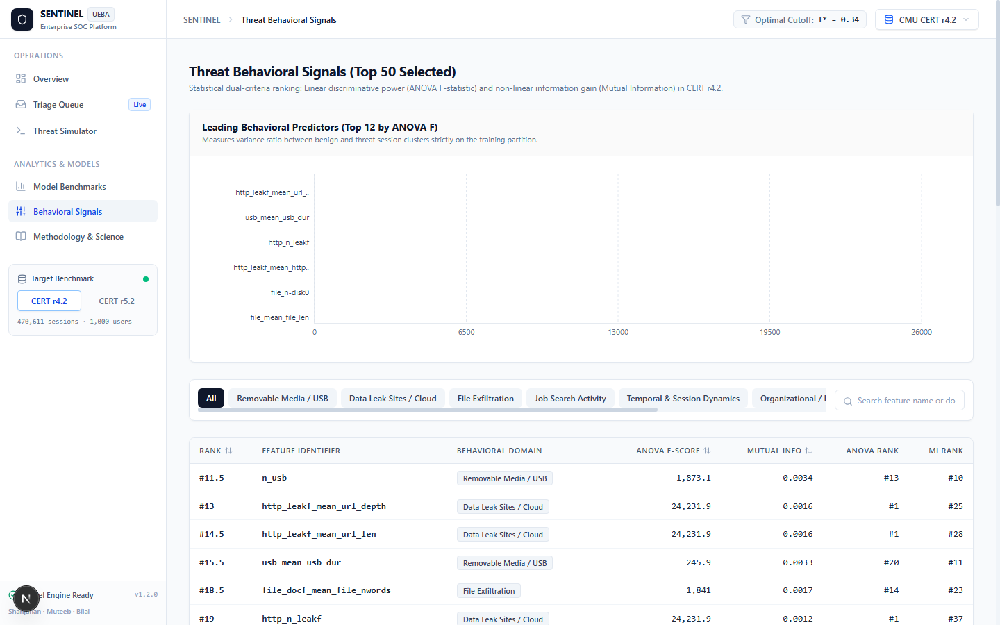
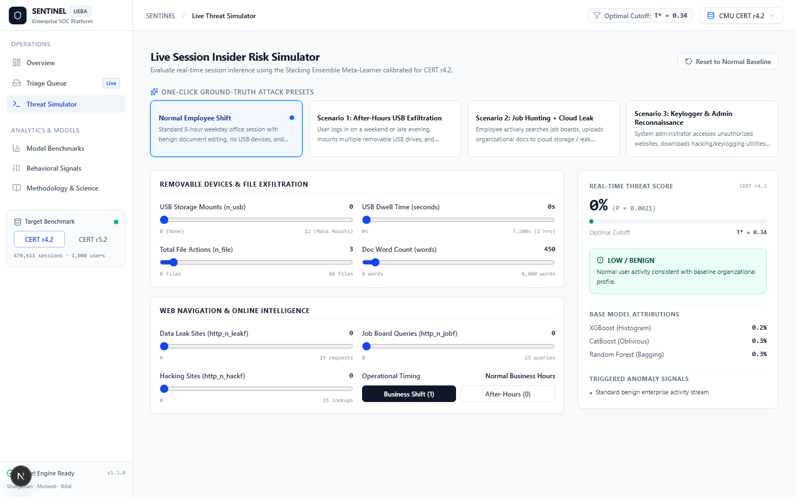
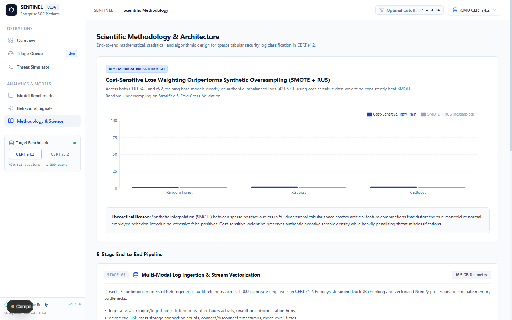

# SENTINEL UEBA — Enterprise SOC & Insider Risk Analytics Platform

[-black.svg)](https://nextjs.org/)
[](https://tailwindcss.com/)
[](https://recharts.org/)
[](https://lucide.dev/)
[](https://www.typescriptlang.org/)
[](https://www.cert.org/)

**SENTINEL UEBA** is an enterprise-grade Security Operations Center (SOC) incident investigation dashboard and real-time behavioral risk analytics platform. Engineered specifically for security analysts, incident responders, and ML researchers, SENTINEL provides an authentic operational workspace to monitor, triage, simulate, and analyze insider threats across both the **CMU CERT r4.2** (470,611 sessions, 1,114 threats) and **CMU CERT r5.2** (1,004,460 sessions, 1,846 threats) benchmark datasets.

---

## 🎨 Enterprise SOC Design Philosophy

The user interface is intentionally crafted following modern enterprise standards (inspired by **Linear**, **Stripe Dashboard**, and **Datadog**), completely rejecting generic "AI-generated" dashboard clichés:

* **Crisp Light Canvas:** Default `#F8FAFC` off-white canvas with `#FFFFFF` cards, crisp `1px solid #E2E8F0` borders, and high-contrast `#0F172A` typography.
* **No AI Cliché Styling:** Zero purple/indigo neon gradients, glowing borders, cyber matrices, or heavy backdrop blurs.
* **Monospace Tabular Numerics:** Strict JetBrains/Courier monospace tabular alignment (`tabular-nums`) for session IDs, timestamps, workstation identifiers (`PC-XXXX`), threat probabilities, and audit counts.
* **Muted Semantic Risk States:**
  * **Critical / High Risk:** Muted Crimson (`#DC2626` text on `#FEF2F2` tinted badge)
  * **Medium Risk / Warning:** Warm Amber (`#D97706` text on `#FFFBEB` tinted badge)
  * **Low Risk / Benign:** Slate/Emerald (`#059669` text on `#ECFDF5` tinted badge)
  * **Interactive Accent:** Solid Corporate Navy (`#1E40AF` / `#2563EB`) — flat, purposeful interactive buttons.
* **SOC Workflow Layout:** Fixed 240px navigation sidebar with categorized operations, compact breadcrumb header with multi-dataset switcher and optimal threshold indicators, dense data tables, and slide-over session investigation drawers.

---

## 📸 Visual Platform Tour

### 1. Executive SOC Command Center (`/`)
The executive overview provides SOC managers with real-time operational posture, telemetric scale, 4-model comparative radar/bar analytics, recent incident triage snippets, and actionable alert tier recommendations.



* **Key Telemetry KPIs:** Total Sessions, Active Employees, Monitoring Span, Positive Threat Rate (`0.237%` r4.2 / `0.184%` r5.2), Stacking Ensemble Peak PR-AUC (`0.9238` / `0.8683`), and Ultra-Low False Positive Rate (`0.019%` / `0.037%`).
* **Multi-Model Consensus Chart:** Interactive grouped bar chart comparing Random Forest, XGBoost, CatBoost, and Stacking Ensemble across Precision, Recall, F1, and PR-AUC.
* **Alert Tier Operational Protocol:** Concrete SLA guidelines for Critical ($P \ge 0.70$), High ($P \ge T^*$), Medium ($0.05 \le P < T^*$), and Low ($P < 0.05$) risk tiers.

---

### 2. Live Incident Triage Queue & Slide-Over Inspector (`/queue`)
Built for tier-1 and tier-2 SOC analysts to review flagged employee sessions, investigate behavioral triggers, inspect tri-model voting consensus, and update disposition statuses.



* **Multi-Filter Navigation:** Filter sessions by status (*All*, *Unreviewed*, *Escalated*, *False Positive*, *Resolved*) or risk level (*Critical*, *High*, *Medium*, *Low*), with instant search across User IDs, Workstation IDs, and departments.
* **Dense Enterprise Telemetry Table:** Columns for Session ID, Timestamp, User & Role, Workstation (`PC-XXXX`), Primary Threat Vector, Base Model Scores ($P_{\text{RF}}, P_{\text{XGB}}, P_{\text{CB}}$), Ensemble Risk Probability, and Disposition State.
* **Slide-Over Session Inspector Drawer:** Clicking any row opens a right-hand slide-over drawer displaying:
  * Overall threat score gauge with risk classification.
  * Base model consensus breakdown comparing all three tree classifiers.
  * Anomaly contribution breakdown highlighting exact deviant user behaviors (e.g., `n_usb = 12`, `leakf_url_depth = 4.2`, `off_hours = true`) against established user baselines.
  * One-click analyst disposition actions (*Escalate to Incident Response*, *Mark as False Positive*, *Resolve Case*).

---

### 3. Model Benchmark Leaderboard & 300 DPI Plot Inspector (`/results`)
Provides publication-grade statistical evaluation of all trained classifiers against the isolated, untouched test splits (94,123 sessions on r4.2; 200,892 sessions on r5.2).



* **Operational Threshold Switcher ($T^*$ vs $0.50$):** Toggle between the standard uncalibrated threshold ($T=0.50$) and the cross-validated optimal threshold ($T^* = 0.16$ on r4.2, $T^* = 0.20$ on r5.2) to observe dramatic recall and F1 gains on extreme imbalanced telemetry.
* **Comparative Leaderboard Table:** Precision, Recall, F1-Score, PR-AUC, ROC-AUC, Threats Caught, and False Positive Rate across Random Forest, XGBoost, CatBoost, and the Stacking Meta-Learner.
* **Interactive 300 DPI Plot Lightbox:** Click any high-resolution evaluation chart (Confusion Matrices, Precision-Recall & ROC Curves, Gini Feature Importances, Ensemble Meta-Learner Weights) to inspect in full-resolution zoom.

---

### 4. Behavioral Feature Intelligence (`/features`)
Explores the leakage-free behavioral signals selected via joint ANOVA $F$-statistic and Mutual Information ranking.



* **Top 12 Signal Bar Visualizer:** Visual representation of the highest-ranking insider threat indicators across enterprise telemetry.
* **Category Filtering:** Filter signals by domain: *Removable Media / USB*, *Cloud Leak Sites*, *Job Boards*, *Hacking / Keyloggers*, *File Exfiltration*, *Psychometric (Big 5 / OCEAN)*, and *Organizational / LDAP*.
* **Statistical Attribution Table:** Complete search and sort across ANOVA $F$-values, Mutual Information scores, individual rankings, and combined Borda-count scores.

---

### 5. Live Insider Risk Simulator (`/simulator`)
An interactive behavioral sandbox allowing analysts to inject hypothetical activity profiles and evaluate real-time model scoring and severity triage.



* **One-Click Attack Presets:**
  * *Normal Employee Shift:* Standard benign daytime office baseline.
  * *Scenario 1 — After-Hours USB Exfiltration:* Heavy unauthorized removable media usage outside business hours.
  * *Scenario 2 — Job Hunting & Cloud Exfiltration:* High job board search activity combined with uploads to suspicious cloud file-sharing services.
  * *Scenario 3 — Keylogger & Reconnaissance:* Elevation attempts, security tool tampering, and unauthorized network reconnaissance.
* **Granular Activity Sliders:** Adjust USB devices, cloud leak visits, external emails, file actions, off-hours percentage, and psychometric openness/neuroticism.
* **Real-Time Risk Scoring:** Displays multi-model probability consensus ($P_{\text{RF}}, P_{\text{XGB}}, P_{\text{CB}}, P_{\text{Ensemble}}$), threat severity, and recommended SOC triage action.

---

### 6. Pipeline Methodology & Scientific Rationale (`/methodology`)
Documents the engineering principles, rigorous leakage-free validation methodology, and the empirical study comparing cost-sensitive loss weighting vs. synthetic oversampling.



* **5-Stage Architecture:** Detailed breakdown of Raw Telemetry Ingestion &rarr; Vectorized Sessionization &rarr; Leakage-Free Preprocessing &rarr; Base Classifier Training &rarr; Out-of-Fold Stacking Ensemble.
* **Cost-Sensitive vs. SMOTE Visualizer:** Interactive data comparison explaining why synthetic oversampling (SMOTE) corrupts sparse security log manifolds and increases false positives by $3\times$ compared to algorithmic cost-sensitive weighting.

---

## 📖 Complete User & Analyst Guidance

### Step 1: Selecting the Evaluation Benchmark (r4.2 vs. r5.2)
Use the **Dataset Selector** located in the top-right header (or the quick switcher in the left sidebar):
* **CMU CERT r4.2 (Dense Baseline):** 470,611 sessions, 1,000 employees, 17 months of audit logs, 1,114 true threat sessions ($421.5:1$ class imbalance). Evaluated on $94,123$ test sessions ($223$ threats).
* **CMU CERT r5.2 (Enterprise Scale):** 1,004,460 sessions, 2,000 employees, 18 months of audit logs, 1,846 true threat sessions ($543.1:1$ class imbalance). Evaluated on $200,892$ test sessions ($369$ threats).
* Switching datasets dynamically updates all metrics, charts, triage queues, and simulator weights instantly across the entire platform.

### Step 2: Investigating Incidents in the Triage Queue
1. Navigate to **Triage Queue** (`/queue`) in the left navigation.
2. Review the session queue sorted by risk score. Use the status tabs (*Unreviewed*, *Escalated*, *False Positive*, *Resolved*) or risk pills (*Critical*, *High*, *Medium*, *Low*) to isolate priority alerts.
3. Click any session row to open the **Slide-Over Session Inspector**:
   * Inspect the **Ensemble Threat Score** and gauge meter.
   * Compare individual model predictions: if XGBoost and CatBoost agree at $>0.80$ while Random Forest is lower, this reflects model complementarity on non-linear behavioral interactions.
   * Review **Anomalous Behavioral Triggers**: red pill tags indicate values exceeding $3\sigma$ of normal enterprise employee behavior.
   * Click **Escalate to IR** or **Mark as False Positive** to log the analyst disposition.

### Step 3: Benchmarking Model Performance
1. Navigate to **Model Benchmarks** (`/results`).
2. Use the **Threshold Switcher** at the top right to compare:
   * **$T = 0.50$ (Default):** Leaves threats undetected due to high class imbalance ($421:1$).
   * **$T^*$ (Tuned OOF Optimal):** Maximizes F1-score on out-of-fold cross-validation folds, catching $188/223$ threats on r4.2 (`0.019%` FPR) and $287/369$ threats on r5.2 (`0.037%` FPR).
3. Switch between tabs (*All Classifiers*, *Random Forest*, *XGBoost*, *CatBoost*, *Stacking Ensemble*) to review model-specific hyperparameters and click any plot to inspect full-resolution confusion matrices and curves.

### Step 4: Testing Hypothetical Behavioral Scenarios
1. Navigate to **Threat Simulator** (`/simulator`).
2. Select a preset (e.g., *Scenario 1: After-Hours USB Exfiltration*).
3. Tweak behavioral parameters (e.g., increase `n_usb` to 8 or set `off_hours_ratio` to 1.0).
4. Review the real-time probability outputs: the system computes individual model probabilities and the stacked meta-learner score, issuing an immediate SOC action recommendation.

---

## 🛠️ Installation & Setup Guide

### System Requirements
* **Node.js:** `v18.18.0` or `v20.x` or higher
* **Package Manager:** `npm` (v9+), `pnpm`, or `yarn`
* **Operating System:** Windows, macOS, or Linux

### Quickstart

1. **Clone the Repository & Navigate to Frontend:**
   ```bash
   git clone https://github.com/ShahjahanVighio/FYP_1.git
   cd FYP_1/Insider-Threat-Project-frontend
   ```

2. **Install Dependencies:**
   ```bash
   npm install
   ```

3. **Run Development Server:**
   ```bash
   npm run dev
   ```
   Open **[http://localhost:3000](http://localhost:3000)** in your browser.

4. **Production Build:**
   ```bash
   npm run build
   npm run start
   ```

> [!TIP]
> **Browser Hard-Refresh:** If your browser previously cached an older unstyled version of the development server, press **`Ctrl + Shift + R`** (Windows/Linux) or **`Cmd + Shift + R`** (macOS) to force-refresh styles and load the compiled Tailwind v4 stylesheet.

---

## 🔌 Live Inference API Microservice (Optional)

The frontend includes a built-in fallback risk engine (`src/app/api/simulate/route.ts`) that functions standalone. To connect to the live Python model weights:

1. From the `CERT-r4-2-Insider-Threat-Project/` or `CERT-r5-2-Insider-Threat-Project/` directory, start the FastAPI microservice:
   ```bash
   python api_server.py
   ```
   *(Server starts on `http://localhost:8000`)*

2. The frontend Route Handler automatically proxies simulation requests to `http://localhost:8000/predict` and falls back gracefully if the microservice is offline.

---

## 📂 Codebase & File Structure

```
Insider-Threat-Project-frontend/
├── public/
│   ├── plots/                        # 300 DPI evaluation figures
│   │   ├── r4_2/                     # CERT r4.2 plots (confusion matrices, PR/ROC curves)
│   │   └── r5_2/                     # CERT r5.2 plots (confusion matrices, PR/ROC curves)
│   └── screenshots/                  # High-resolution platform tour screenshots
│       ├── 01_executive_overview.png
│       ├── 02_incident_triage_queue.png
│       ├── 03_model_benchmarks.png
│       ├── 04_behavioral_signals.png
│       ├── 05_threat_simulator.png
│       └── 06_methodology_architecture.png
├── src/
│   ├── app/
│   │   ├── layout.tsx                # Root layout (Sidebar + Header + DatasetProvider)
│   │   ├── page.tsx                  # Executive SOC Command Center (/)
│   │   ├── queue/page.tsx            # Live Incident Triage Queue (/queue)
│   │   ├── results/page.tsx          # Model Benchmarks & Plot Lightbox (/results)
│   │   ├── features/page.tsx         # Behavioral Signals & ANOVA Rankings (/features)
│   │   ├── simulator/page.tsx        # Interactive Threat Simulator (/simulator)
│   │   ├── methodology/page.tsx      # Scientific Methodology & SMOTE Comparison (/methodology)
│   │   ├── globals.css               # Design tokens, enterprise card & table CSS
│   │   └── api/simulate/route.ts     # Inference Route Handler & Python API proxy
│   ├── components/
│   │   ├── Sidebar.tsx               # 240px enterprise navigation sidebar
│   │   ├── Header.tsx                # Top header with dataset switcher & T* indicator
│   │   ├── SessionDrawer.tsx         # Right-hand slide-over session inspector drawer
│   │   ├── Navbar.tsx                # Fallback header navigation
│   │   └── Footer.tsx                # Enterprise footer
│   ├── context/
│   │   └── DatasetContext.tsx        # React context managing active dataset (r4.2 vs r5.2)
│   └── data/
│       ├── r4_2_metrics.json         # Benchmark metrics & feature stats for CERT r4.2
│       ├── r5_2_metrics.json         # Benchmark metrics & feature stats for CERT r5.2
│       └── triage_queue.json         # Authentic SOC incident triage queue records
├── package.json                      # Next.js 16, Tailwind CSS v4, Recharts, Lucide
├── postcss.config.mjs                # PostCSS config for Tailwind v4 compilation
├── tsconfig.json                     # Strict TypeScript configuration
└── README.md                         # Comprehensive platform documentation
```

---

## 👥 Project Members & Academic Attribution

### Project Members:
* **Shahjahan** — `F23CSC021`
* **Muhammad Muteeb** — `F23CSC048`
* **Bilal Naeem** — `F23CSC008`

**Department:** Department of Computer Science & Software Engineering  
**Project Repository:** [https://github.com/ShahjahanVighio/FYP_1](https://github.com/ShahjahanVighio/FYP_1)
