# An Ensemble Machine Learning Approach to Insider Threat Detection Using Cultural Metrics and System Behaviors

[]()
[](https://resources.sei.cmu.edu/library/asset-view.cfm?assetid=508099)
[]()
[](https://www.python.org/)
[](https://nextjs.org/)
[](https://tailwindcss.com/)
[](CERT-r4-2-Insider-Threat-Project/license.txt)
[]()

> **Final Year Project (FYP)**  
> **Domain**: Cybersecurity · User & Entity Behavior Analytics (UEBA) · Enterprise Machine Learning  
> **Author**: Final Year Project Research Team  
> **Benchmark Datasets**: Carnegie Mellon University Software Engineering Institute (CMU SEI) CERT Insider Threat Synthetic Test Suite (Releases 4.2 & 5.2)  
> **Scale**: Over **`1,475,000` combined extracted user sessions** across 35 cumulative monitoring months, 3,000 employees, and 129 ground-truth threat actors.

---

## 📌 Executive Summary & Abstract

Detecting malicious insider threats within enterprise IT networks is one of the most intractable challenges in modern cybersecurity. Malicious actions—ranging from data exfiltration and intellectual property theft to IT sabotage—occur hidden within immense volumes of routine employee activity. In authentic security logs, malicious sessions represent **less than 0.25% of total enterprise activity** (imbalance ratios exceeding `421:1` in r4.2 and `543:1` in r5.2). Standard machine learning classifiers trained naively on such telemetry suffer from crippling false alarm floods or catastrophic detection blind spots.

This monorepo houses a comprehensive, publication-grade research framework and operational Security Operations Center (SOC) dashboard that addresses this challenge through:
1. **High-Throughput Vectorized Sessionization**: Processing over 54 GB of multi-source audit logs (logon/logoff, USB devices, file actions, email metadata, HTTP browsing, monthly LDAP rosters, and psychometric Big Five OCEAN scores) into structured, behavioral sessions.
2. **Leakage-Free Dual-Criteria Feature Selection**: Selecting the Top 50 non-redundant signals using combined linear (ANOVA $F$-statistic) and non-linear (Mutual Information) criteria strictly on training partitions.
3. **Rigorous Empirical Imbalance Benchmark**: Proving across **1.475 million sessions** that **Cost-Sensitive Class Weighting decisively outperforms synthetic oversampling (SMOTE + RUS)** on tabular security logs.
4. **Out-of-Fold (OOF) Stacking Meta-Learner**: Fusing diverse algorithmic strengths—**Random Forest** (Bagging variance reducer), **XGBoost** (Precision anchor), and **CatBoost** (Recall anchor)—via an enriched, calibrated meta-learner to achieve state-of-the-art PR-AUC with microscopic false positive rates (`0.019%` on r4.2 and `0.037%` on r5.2).
5. **Executive SOC Dashboard & Real-Time Risk Simulator**: A production-ready Next.js 16 + Tailwind CSS frontend interface with live scenario simulation and plug-and-play multi-dataset switching.

---

## 🗂️ Monorepo Structure & Quick Links

This repository is organized into three clean, self-contained subprojects:

| Subproject Directory | Focus & Benchmark | Total Sessions | Ground-Truth Threats | Key Outcome | Link |
| :--- | :--- | :---: | :---: | :--- | :---: |
| **`CERT-r4-2-Insider-Threat-Project/`** | CMU CERT Release 4.2 (17 Months, 1,000 Employees) | `470,611` | `1,114` (421:1 ratio) | **PR-AUC: `0.9238`**, F1: `84.49%`, 188/223 threats caught, 18 FPs | [Explore r4.2 →](CERT-r4-2-Insider-Threat-Project/README.md) |
| **`CERT-r5-2-Insider-Threat-Project/`** | CMU CERT Release 5.2 (18 Months, 2,000 Employees, Scenarios 1–4) | `1,004,460` | `1,846` (543:1 ratio) | **PR-AUC: `0.8683`**, F1: `78.52%`, 287/369 threats caught, 75 FPs | [Explore r5.2 →](CERT-r5-2-Insider-Threat-Project/README.md) |
| **`Insider-Threat-Project-frontend/`** | Executive SOC Command Center & Live Threat Simulator | *Multi-Dataset Ready* | *Plug-in Ready* | Next.js 16, Recharts, Real-time scenario injection | [Explore Frontend →](Insider-Threat-Project-frontend/README.md) |

---

## 🏗️ End-to-End System Architecture

```mermaid
flowchart TD
    subgraph DataIngestion["1. Multi-Source Raw Telemetry (54.7 GB Total)"]
        D1["Logon/Logoff Activity (logon.csv)"]
        D2["Removable Media / USB Events (device.csv)"]
        D3["File System Operations (file.csv)"]
        D4["Organizational Email Logs (email.csv)"]
        D5["Web Navigation & HTTP Logs (http.csv)"]
        D6["Big Five Psychometric Scores (psychometric.csv)"]
        D7["Monthly LDAP Hierarchy Snapshots (LDAP/)"]
    end

    subgraph FeatureEngineering["2. High-Speed Vectorized Sessionization"]
        E1["DuckDB SQL Streaming + NumPy Vectorized Aggregation"]
        E2["Session Delimitation: Logon -> Logoff per User & Machine"]
        E3["Temporal Slicing: Workhour, Afterhour, Weekend Day, Weekend Night"]
        E4["128 Engineered Behavioral, Content, and Organizational Signals"]
        E5["Ground-Truth Label Alignment (answers/insiders.csv)"]
    end

    subgraph Preprocessing["3. Leakage-Free Preprocessing & Selection"]
        P1["80/20 Stratified Partitioning (Test Sets Strictly Isolated)"]
        P2["Train-Fitted Median Imputation & Z-Score Standardization"]
        P3["Dual Criteria: ANOVA F-Test + Mutual Information Ranking"]
        P4["Top 50 Optimal Non-Redundant Signals Extracted"]
        P5["Imbalance Branches: Cost-Sensitive vs. SMOTE + RUS"]
    end

    subgraph BaseLearners["4. Base Classifiers (Stratified 5-Fold CV)"]
        B1["Random Forest\n(Bagging Variance Anchor\nbalanced_subsample)"]
        B2["XGBoost\n(Precision Anchor\nscale_pos_weight optimization)"]
        B3["CatBoost\n(Recall Anchor\nSqrtBalanced loss)"]
    end

    subgraph StackingEnsemble["5. Out-of-Fold Stacking Meta-Learner"]
        M1["5-Fold Out-of-Fold Probability Generation (P_RF, P_XGB, P_CB)"]
        M2["Calibrated Logistic Regression with Enriched Features"]
        M3["Decision Threshold Calibration on OOF (T* r4.2: 0.34, r5.2: 0.42)"]
        M4["Final Generalization Evaluation on Untouched Test Sets"]
    end

    subgraph Delivery["6. Presentation & Operationalization"]
        UI1["Executive SOC Command Center (Next.js 16)"]
        UI2["Interactive Threshold & Leaderboard Explorer"]
        UI3["Live Risk Simulator with Preset Attack Scenarios"]
        UI4["FastAPI Real-Time Inference Microservice (api_server.py)"]
    end

    DataIngestion --> FeatureEngineering
    FeatureEngineering --> Preprocessing
    Preprocessing --> BaseLearners
    BaseLearners --> StackingEnsemble
    StackingEnsemble --> Delivery
```



---

## 📊 Cross-Release Master Comparison: CERT r4.2 vs. CERT r5.2

The table below summarizes dataset characteristics and empirical test results across both benchmarks on strictly untouched test sets:

| Dimension / Metric | CMU CERT Release 4.2 | CMU CERT Release 5.2 | Cross-Release Analysis |
| :--- | :---: | :---: | :--- |
| **Duration & Timeline** | 17 Months (Jan 2010 – May 2011) | 18 Months (Jan 2010 – Jun 2011) | r5.2 spans full 75 calendar weeks |
| **Monitored Employees** | 1,000 Users | 2,000 Users | 2× employee enterprise scale in r5.2 |
| **Raw Telemetry Volume** | 16.5 GB | 38.2 GB | 2.3× raw event volume in r5.2 |
| **Total Extracted Sessions** | **`470,611`** | **`1,004,460`** | Over 1M user sessions in r5.2 |
| **Ground-Truth Threats** | 1,114 Sessions (30 Users) | 1,846 Sessions (99 Users) | Scenarios 1–4 covered in r5.2 |
| **Class Imbalance Ratio** | **421.5 : 1** (0.2367% threats) | **543.1 : 1** (0.1838% threats) | 29% higher needle-in-haystack sparsity |
| **Train / Test Sessions** | 376,488 / 94,123 | 803,568 / 200,892 | 80/20 Stratified Partitioning |
| **Isolated Test Threats** | 223 Sessions | 369 Sessions | Strictly untouched during all training |
| **Optimal Feature Count** | Top 50 (from 128 engineered) | Top 50 (from 128 engineered) | Combined ANOVA $F$ + Mutual Information |
| **Top Predictive Signal** | `usb_mean_usb_dur` | `usb_mean_usb_dur` | USB dwell time is #1 indicator |
| **Random Forest PR-AUC** | `0.8086` (ROC: `0.9859`) | `0.6962` (ROC: `0.9763`) | Robust baseline across both releases |
| **XGBoost PR-AUC** | `0.9160` (ROC: `0.9986`) | `0.8378` (ROC: `0.9987`) | **Precision Leader** (82.5%–86.5%) |
| **CatBoost PR-AUC** | `0.9082` (ROC: `0.9984`) | `0.8532` (ROC: `0.9984`) | **Recall Leader** (74.8%–82.5%) |
| **Stacking Ensemble PR-AUC** | **`0.9238`** (ROC: `0.9987`) | **`0.8683`** (ROC: `0.9989`) | **Overall Winner** on both benchmarks |
| **Ensemble F1-Score ($T^*$)** | **`84.49%`** ($T^* = 0.34$) | **`78.52%`** ($T^* = 0.42$) | Optimal harmonic balance |
| **Ensemble Threats Caught** | **188 / 223 (84.30%)** | **287 / 369 (77.78%)** | Highest threat interception count |
| **False Positive Rate (FPR)** | **`0.0192%`** (18 FPs / 93,900) | **`0.0374%`** (75 FPs / 200,523) | Ultra-low enterprise SOC noise |

---

## 🔬 Core Empirical Findings & Scientific Contributions

### 1. Cost-Sensitive Loss Weighting Consistently Dominates Resampling
A critical question in insider threat research is whether to synthesize positive cases (e.g. SMOTE) or adjust algorithm loss weights. In both benchmarks, across Stratified 5-Fold Cross-Validation, **Cost-Sensitive Weighting outperformed SMOTE + RUS on every model family**:

```
Cross-Validation PR-AUC Comparison:
-------------------------------------------------------------------------------------
Model Architecture        Release 4.2 (CS vs. SMOTE)       Release 5.2 (CS vs. SMOTE)
-------------------------------------------------------------------------------------
Random Forest             0.7539  vs.  0.5389 (+21.5%)     0.6466  vs.  0.5716 (+7.5%)
XGBoost                   0.8981  vs.  0.8385 (+6.0%)      0.7851  vs.  0.7335 (+5.2%)
CatBoost                  0.8855  vs.  0.8011 (+8.4%)      0.7965  vs.  0.6792 (+11.7%)
-------------------------------------------------------------------------------------
```
**Scientific Explanation**: In dense security telemetry, benign activities outnumber threats by `400:1` to `540:1`. Synthetic interpolation (SMOTE) across 50 heterogeneous features corrupts discrete indicator distributions (e.g., USB connection flags, count distributions), degrading generalization. Direct cost-sensitive class weighting preserves real-world distribution density while heavily penalizing threat misses.

### 2. Multi-Model Algorithmic Complementarity
- **Random Forest (Bagging)**: Acts as a variance stabilizer across thousands of low-correlation decision trees.
- **XGBoost (Histogram Boosting)**: Maximizes **Precision** (leading to the fewest false alarms: 18 FPs on r4.2, 57 FPs on r5.2).
- **CatBoost (Symmetric Oblivious Trees)**: Maximizes **Recall** (intercepting the most threats among single models: 184 on r4.2, 276 on r5.2).
- **Stacking Meta-Learner**: Combines these complementary decision boundaries using out-of-fold probability vectors to achieve the highest overall PR-AUC and threat detection count on both benchmarks.

---

## 🚀 Quickstart & Reproducibility Guide

### 1. Global Setup
Clone the monorepo:
```bash
git clone https://github.com/ShahjahanVighio/FYP_1.git
cd FYP_1
```

Install Python dependencies:
```bash
pip install numpy pandas scipy scikit-learn xgboost catboost imbalanced-learn matplotlib seaborn pyarrow fastparquet duckdb tqdm joblib fastapi uvicorn
```

---

### 2. Running CERT r4.2 Benchmark
Navigate to the r4.2 directory:
```bash
cd CERT-r4-2-Insider-Threat-Project

# Preprocessing & 80/20 Stratified Split
python data_prep.py

# Train Base Models
python train_rf.py
python train_xgb.py
python train_cb.py

# Train Stacking Ensemble Meta-Learner
python train_meta_learner.py
```
> See [`CERT-r4-2-Insider-Threat-Project/README.md`](CERT-r4-2-Insider-Threat-Project/README.md) for full details.

---

### 3. Running CERT r5.2 Benchmark
Navigate to the r5.2 directory:
```bash
cd ../CERT-r5-2-Insider-Threat-Project

# Session Extraction (from raw r5.2 logs)
python session_extractor.py

# Preprocessing & 80/20 Stratified Split
python data_prep.py

# Train Base Models
python train_rf.py
python train_xgb.py
python train_cb.py

# Train Stacking Ensemble Meta-Learner
python train_meta_learner.py
```
> See [`CERT-r5-2-Insider-Threat-Project/README.md`](CERT-r5-2-Insider-Threat-Project/README.md) for full details.

---

### 4. Running the Executive SOC Dashboard
Navigate to the frontend directory:
```bash
cd ../Insider-Threat-Project-frontend

# Install Node dependencies
npm install

# Start local Next.js development server
npm run dev
```
Open **[http://localhost:3000](http://localhost:3000)** in your browser to explore the interactive Command Center, Methodology Explorer, Results Lightbox, Threat Feature Matrix, and Live Simulator.

> See [`Insider-Threat-Project-frontend/README.md`](Insider-Threat-Project-frontend/README.md) for full frontend documentation.

---

## 👥 Contributors & Academic Acknowledgments

- **Final Year Project Team**: Department of Computer Science & Software Engineering
- **Dataset Reference**: Glasser, J., & Lindauer, B. (2013). *Bridging the gap: A pragmatic approach to generating insider threat synthetic data*. Carnegie Mellon University, Software Engineering Institute (SEI).

---

## 📜 License

This project is licensed for academic, educational, and research use under the terms outlined in [license.txt](CERT-r4-2-Insider-Threat-Project/license.txt).
